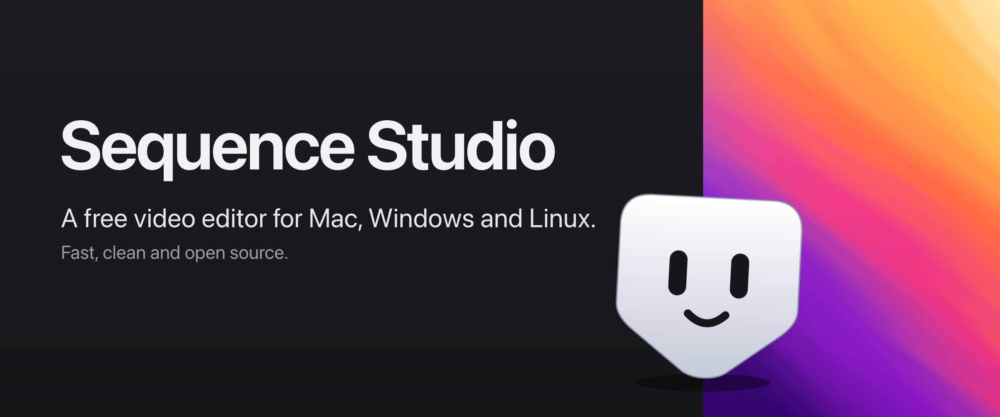
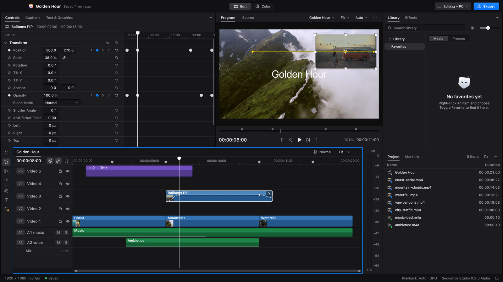
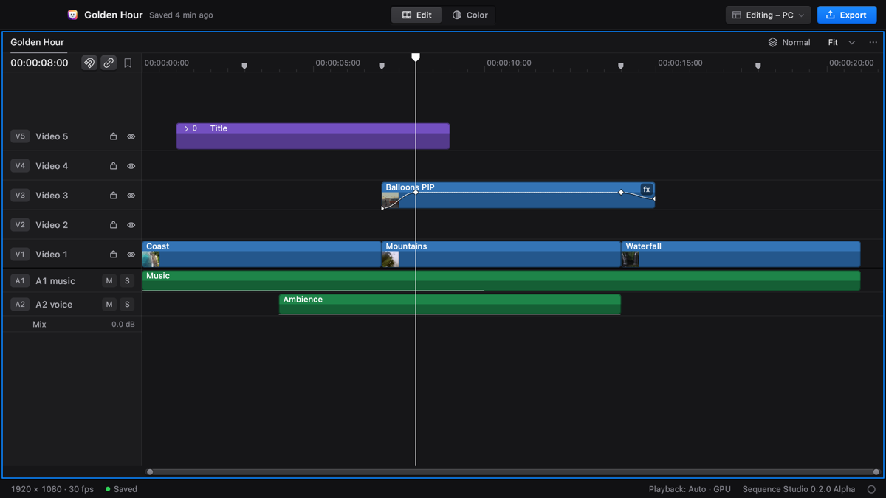
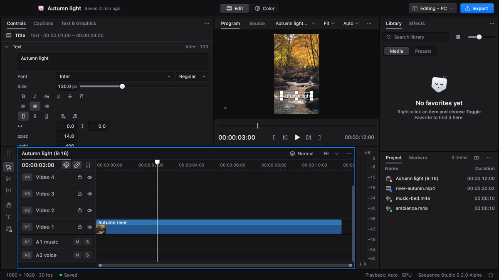
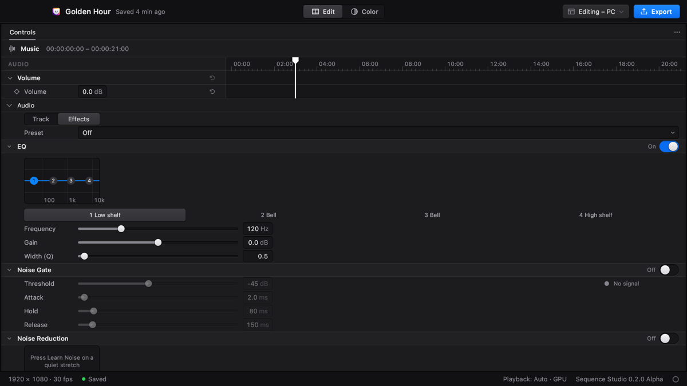
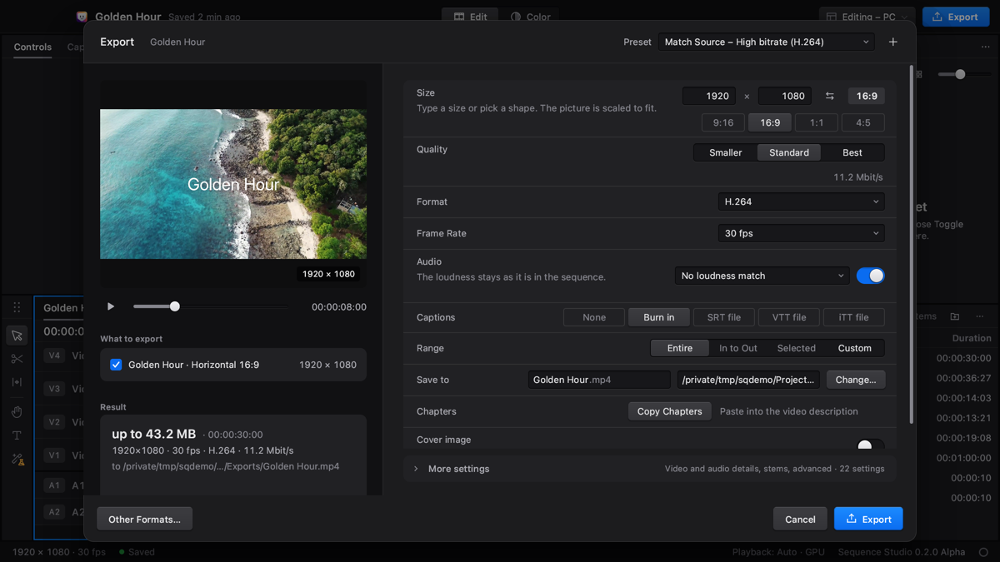
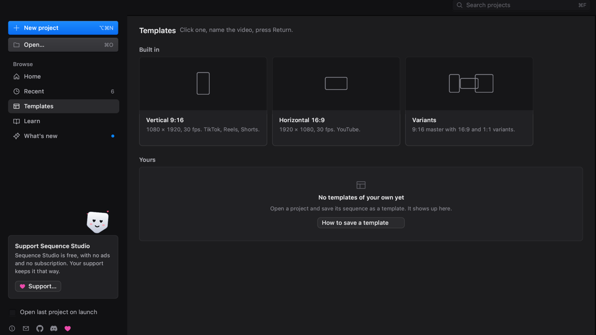

<div align="center">



### The open-source video editor that stays out of your way.

Cut, grade, caption and export short-form video in one fast app. For Mac, Windows and Linux.<br>
**Open source (GPL-3.0). The alpha is a free download. No account, no watermark.**

[](https://github.com/paulherter/sequence-studio/releases)
[](https://github.com/paulherter/sequence-studio/issues/new/choose)

[](ROADMAP.md)
[](https://getsequencestudio.com)
[](https://discord.gg/q6KPQc8WCA)
[](https://getsequencestudio.com/supporter/)

[](LICENSE)


[**Roadmap**](ROADMAP.md) &middot; [Install](#-install) &middot; [Why](#-why-sequence-studio) &middot; [Features](#-features) &middot; [Status](#-status-alpha) &middot; [Community](#-community-and-support) &middot; [Formats](#formats) &middot; [Contributing](#contributing)



</div>

## 📦 Install

- **Mac:** download [SequenceStudio-mac.dmg](https://github.com/paulherter/sequence-studio/releases/latest/download/SequenceStudio-mac.dmg), open it and drag Sequence Studio to Applications. The app is notarized by Apple. Needs Apple Silicon and macOS 26 or later.
- **Windows:** download [SequenceStudio-windows-setup.exe](https://github.com/paulherter/sequence-studio/releases/latest/download/SequenceStudio-windows-setup.exe) and run it; no administrator rights needed. Needs Windows 10 or 11, x64. The installer is not code-signed yet, so SmartScreen may say "Windows protected your PC": click **More info**, then **Run anyway**.
- **Linux:** one command in a terminal. It installs the AppImage for your user and adds a menu entry. Needs x86-64 and a Vulkan graphics driver.

  ```sh
  curl -fsSL https://raw.githubusercontent.com/paulherter/sequence-studio/main/scripts/install.sh | sh
  ```

  Or download the [AppImage](https://github.com/paulherter/sequence-studio/releases/latest/download/SequenceStudio-linux-x86_64.AppImage) yourself, make it executable and run it. The script is short; read [install.sh](scripts/install.sh) before you run it if you like.

All files are on the [latest release](https://github.com/paulherter/sequence-studio/releases/latest). Step by step:
[Getting started](docs/manual/01-getting-started.md).

**Free or paid?** While Sequence Studio is in alpha, all downloads are free. From the first stable release, the
ready-made builds (signed and notarized `.dmg`, Windows installer, updates) are paid to fund development; the price is
not set yet. The source code stays open under the GPL-3.0, so you can always build it yourself, see
[Build from source](#build-from-source).

## ✨ Why Sequence Studio

- **Feels familiar.** A multi-track timeline, Source and Program monitors and Effect Controls, where you expect them.
  If you have edited before, you can start cutting right away.
- **Fast.** Written in Rust. The picture is drawn on the GPU (Metal on the Mac, Direct3D 12 on Windows, Vulkan on
  Linux) and decoding is hardware accelerated where the system offers it. The editor stays responsive, also on smaller
  machines.
- **Uncluttered.** One tool per job, no panels you never open, no upsell. Panels dock, tab and float.
- **Made for short-form.** Rough cut, b-roll, titles, captions, a quick grade, export for vertical and widescreen.
- **One codebase.** The editor UI and engine logic are shared between macOS, Windows and Linux, so a feature is written once and looks the same everywhere.
- **Open source, free during the alpha.** Download the alpha builds for free. From the first stable release the ready-made builds are paid. The source stays open under the GPL-3.0.

## 🎬 Features

<table>
<tr>
<td width="50%" valign="top">
<br>
<b>Timeline</b><br>
Multi-track editing with ripple, roll, slip and slide trims, insert and overwrite, razor, markers, nested sequences,
undo for everything and autosave. <b>Fast Cut</b> sequences add a magnetic mode where every edit closes gaps for you.
</td>
<td width="50%" valign="top">
<br>
<b>Playback</b><br>
Hardware decoding, frame cache and prefetch, proxy generation for heavy footage, and GPU compositing that matches
the export. Monitors can float as their own windows. An optional guide draws a platform UI mock over the Program
monitor.
</td>
</tr>
<tr>
<td width="50%" valign="top">
<br>
<b>Effects and motion</b><br>
Transform with keyframes and curves, blurs, drop and long shadows, outline, trails, transitions, speed changes and
Lottie animations. Quick Apply puts a favorite effect or preset on the selected clip from a search popup.
</td>
<td width="50%" valign="top">
<br>
<b>Color</b><br>
Grading with scopes and LUTs, and Match Color, which matches one clip to the look of another.
</td>
</tr>
<tr>
<td width="50%" valign="top">
<br>
<b>Masks, tracking and analysis</b><br>
Shape masks, picture (matte) masks, Magic Mask (click a subject, then track it), point and mask tracking,
stabilization, auto reframe and scene-change detection. Gyro-based stabilization uses
<a href="https://github.com/gyroflow/gyroflow">Gyroflow</a>. Magic Mask, tracking and stabilization are still
experimental.
</td>
<td width="50%" valign="top">
<br>
<b>Titles and captions</b><br>
Text layout with bundled open fonts, caption styles, on-device speech transcription
(<a href="https://github.com/ggml-org/whisper.cpp">whisper.cpp</a> on Mac, Windows and Linux) and subtitle import. Premiere-authored
<code>.mogrt</code> templates can be imported as title templates.
</td>
</tr>
<tr>
<td width="50%" valign="top">
<br>
<b>Audio</b><br>
Per-track and per-clip effects, noise suppression, silence removal, ducking, loudness normalization on export.
</td>
<td width="50%" valign="top">
<br>
<b>Export</b><br>
A queue with progress, presets for common social formats, smart rendering where possible and an optional
sidecar <code>.srt</code>. H.264, HEVC and ProRes on all three systems.
</td>
</tr>
</table>

Also in the box: a start window with recents, 9:16 and 16:9 starting points and templates; Premiere Pro project and
effect preset import (experimental, the import report lists what was skipped); Lottie and `.mogrt` import; and an
optional local HTTP/MCP edit API so scripts and agents can read and edit the open project (off by default, see
[docs/EDIT-API.md](docs/EDIT-API.md)).

<div align="center">

</div>

## 🚧 Status: Alpha

Sequence Studio is alpha software. It already does a lot, but most of it has had limited hands-on testing, so expect
rough edges. Project files may change between versions: keep backups and do not use it for paid work yet. The
[Roadmap](ROADMAP.md) lists known problems and what comes next.

**One app on three systems.** The editor UI (timeline, monitors, inspector, color, text, library, dialogs) and the
engine are written once in Rust and shared; only the window, media, GPU and audio backends differ per system.

**Works today**

- Timeline editing, Fast Cut magnetic sequences, undo, autosave, nested sequences, markers, floating panels.
- Playback with hardware decoding, caches and proxies, with the same compositor as the export.
- Effects, keyframes and curves, transitions, speed, Quick Apply, Lottie clips, shape and picture masks.
- Color grading with scopes, LUTs and Match Color, titles, captions, on-device transcription, audio effects.
- Export queue with social presets, H.264, HEVC and ProRes, loudness normalization.
- Premiere Pro project import, `.mogrt` template import, local edit API.

**Not there yet**

- Magic Mask, mask and point tracking, stabilization (including Gyroflow) and auto reframe are experimental.
- The Windows and Linux builds are new in 0.2.0: expect more rough edges than on the Mac. The Windows installer is not
  code-signed yet. Some commands answer "not available on this computer yet".
- No Intel Mac, no Windows on ARM, no Linux on ARM.
- Premiere import covers a subset of effects and project features.
- Plugin support and a node-based color mode are not started.

See the [Roadmap](ROADMAP.md) for details. Found a bug or missing something? [Open an issue](https://github.com/paulherter/sequence-studio/issues/new/choose) or tell us in [Discord](https://discord.gg/q6KPQc8WCA). Feedback shapes what gets built next.

## 💬 Community and support

- **Chat:** [join the Discord](https://discord.gg/q6KPQc8WCA) to ask questions, show your edits and meet Pip, the helper bot.
- **Website:** [getsequencestudio.com](https://getsequencestudio.com), with downloads for Mac, Windows and Linux.
- **Support the project:** Sequence Studio is made by one person, with no ads and no investors. If you like it, [buy Pip a coffee](https://getsequencestudio.com/supporter/) once or monthly. Supporters get a key and can be named in the credits.
- **What's next:** the [Roadmap](ROADMAP.md) lists what is planned and where you can help.
- **Bugs and ideas:** [open an issue](https://github.com/paulherter/sequence-studio/issues/new/choose).

## Formats

| | |
|---|---|
| Import (video) | iPhone HEVC (SDR and HDR/HLG), H.264, camera footage such as Sony XAVC (S-Log3), ProRes, `.mkv` and `.webm` |
| Import (other) | Still images, animated PNG, Lottie, subtitle files, Premiere Pro projects, `.mogrt` templates |
| Export | H.264, HEVC, ProRes (422, 422 HQ, 4444), with presets for social formats |

## Build from source

The same steps work on macOS, Windows and Linux. You need Rust (`rustup` installs the toolchain that
`rust-toolchain.toml` pins), a C/C++ compiler and an FFmpeg shared build (`brew install ffmpeg pkg-config` on the Mac;
other systems: see [DEVELOPING.md](DEVELOPING.md)).

```sh
cargo run -p sequence-studio     # starts the app
cargo xtask check                # fmt, clippy and tests for the whole workspace
cargo xtask package              # Mac .app (add --dmg) or Linux AppImage; Windows: packaging/windows/build-installer.ps1
```

Test footage is not in the repository: keep your own files in a git-ignored folder. Per-system setup, headless modes
and packaging are in [DEVELOPING.md](DEVELOPING.md); the crate map is in [ARCHITECTURE.md](ARCHITECTURE.md); rules for
changes are in [CONTRIBUTING.md](CONTRIBUTING.md).

## Contributing

**What is planned next is in the [Roadmap](ROADMAP.md).** Pick something, or tell us what matters to you. Issues and pull requests are welcome, in English. Please open an issue before starting larger work. Read
[CONTRIBUTING.md](CONTRIBUTING.md) and the [Code of Conduct](CODE_OF_CONDUCT.md) first. Security problems: see
[SECURITY.md](SECURITY.md). Questions and ideas are welcome as issues.

## License and credits

GPL-3.0-or-later, see [LICENSE](LICENSE), with additional terms under section 7 in
[LICENSE-ADDITIONAL-TERMS.md](LICENSE-ADDITIONAL-TERMS.md): forks must keep the credit "Based on Sequence Studio by
Paul Herter" and need their own name and icon. The name, logo and the mascot Pip are not under the GPL, see
[BRAND.md](BRAND.md). Every binary release links the source tag it was built from.
Third-party code, fonts and libraries with their licenses are listed in [docs/THIRD_PARTY.md](docs/THIRD_PARTY.md),
among them Gyroflow (GPL-3.0), ThorVG (MIT), RNNoise (BSD-3-Clause) and the bundled OFL fonts.

Sequence Studio is an independent project. Not affiliated with Adobe; Premiere Pro is a trademark of Adobe. Other
product names are trademarks of their owners and are used for identification only.

Built with help from [Claude](https://claude.com/claude-code), Anthropic's coding assistant.
