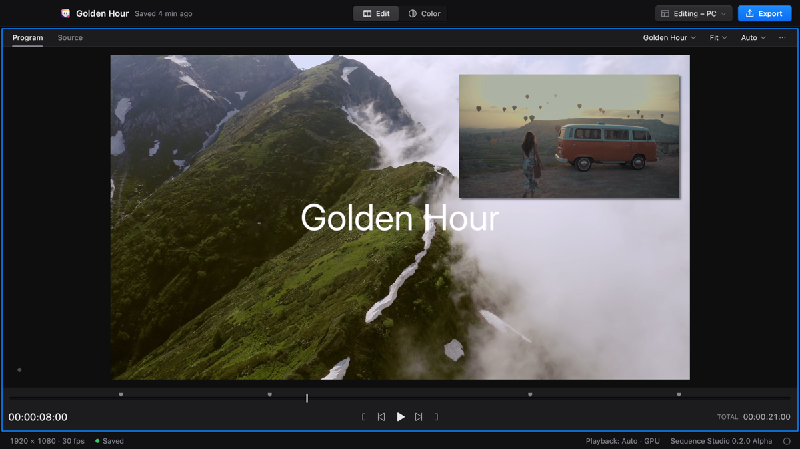
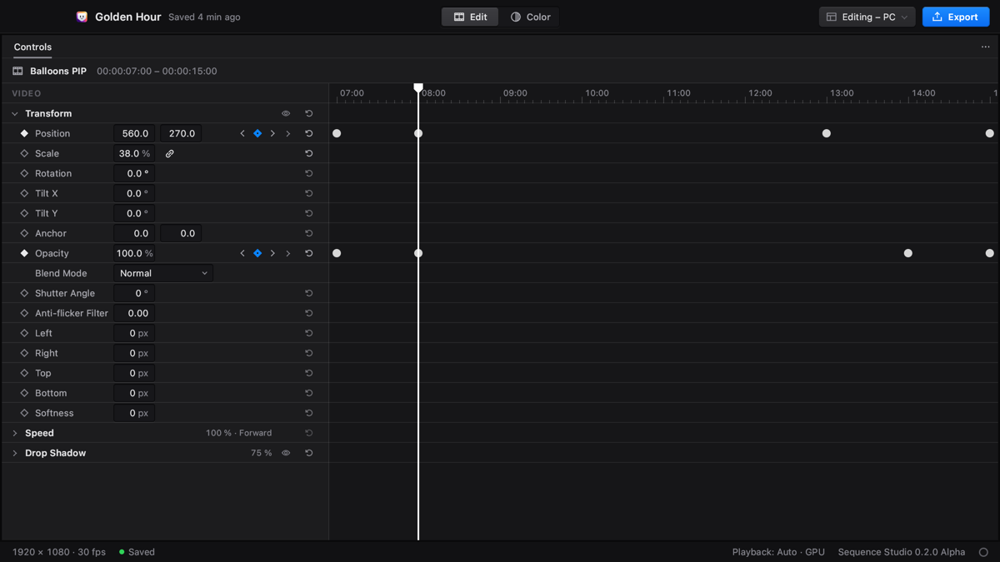
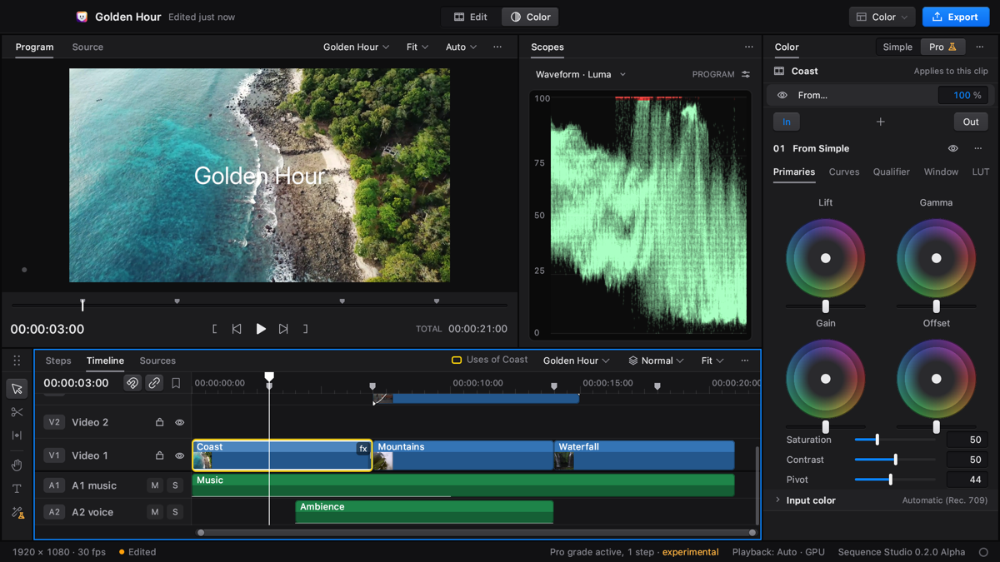
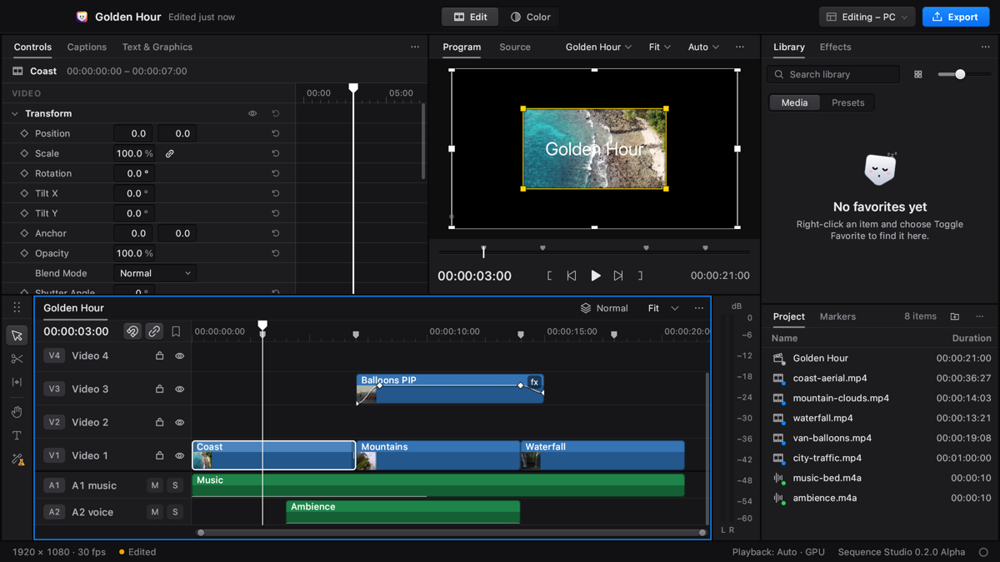

<div align="center">


### A free, open-source video editor for Mac, Windows and Linux.

Cut, grade, caption and export short-form video, with one engine and one interface on all three systems.

[Download](https://github.com/paulherter/sequence-studio/releases/latest) &middot; [Website](https://getsequencestudio.com) &middot; [Discord](https://discord.gg/q6KPQc8WCA) &middot; [Roadmap](ROADMAP.md) &middot; [Report a bug](https://github.com/paulherter/sequence-studio/issues/new/choose)

[](https://github.com/paulherter/sequence-studio/releases/latest)
[](LICENSE)


</div>

## Install

Sequence Studio is completely free: no account, no trial, no watermark.

| System | Needs | Get it |
|---|---|---|
| Mac | Apple Silicon, macOS 26 or later | [SequenceStudio-mac.dmg](https://github.com/paulherter/sequence-studio/releases/latest/download/SequenceStudio-mac.dmg): open it and drag the app to Applications. Apple has notarized it. |
| Windows | Windows 10 or 11, x64 | [SequenceStudio-windows-setup.exe](https://github.com/paulherter/sequence-studio/releases/latest/download/SequenceStudio-windows-setup.exe): run it, no administrator rights needed. |
| Linux | x86-64, a Vulkan graphics driver, glibc 2.35 or newer (Ubuntu 22.04 or Linux Mint 21 and later) | The one-line install below, or the [AppImage](https://github.com/paulherter/sequence-studio/releases/latest/download/SequenceStudio-linux-x86_64.AppImage). |

The Windows installer is not code-signed yet, so SmartScreen may say "Windows protected your PC". Click **More info**, then **Run anyway**.

On Linux, one command installs the AppImage for your user and adds a menu entry. It needs no sudo, and the script is short enough to read first: [install.sh](scripts/install.sh).

```sh
curl -fsSL https://raw.githubusercontent.com/paulherter/sequence-studio/main/scripts/install.sh | sh
```

All files are on the [latest release](https://github.com/paulherter/sequence-studio/releases/latest). Step by step: [Getting started](docs/manual/01-getting-started.md).

## Why Sequence Studio

- **Familiar.** The timeline, the Source and Program monitors and Effect Controls are where you expect them, so you can start cutting right away.
- **Quick.** Video decodes on the GPU where the system allows it, and the editor keeps up while you scrub.
- **Plain.** Each job has one tool. Panels dock, tab and float, and the rest stays out of your way.
- **Built for short videos.** Rough cut, b-roll, titles, captions, a quick grade, then export in vertical or widescreen.
- **The same everywhere.** The interface and the engine are one codebase. Only the window, media, GPU and audio code differ per system.

## Features

<table>
<tr>
<td width="50%" valign="top">
<br>
<b>Timeline</b><br>
Multi-track editing with ripple, roll, slip and slide trims, insert and overwrite, razor, markers, nested sequences,
undo for everything and autosave. <b>Fast Cut</b> sequences add a magnetic mode where every edit closes gaps for you.
</td>
<td width="50%" valign="top">
<br>
<b>Playback</b><br>
Hardware decoding, frame cache and prefetch, proxies for heavy footage, and GPU compositing that matches the export.
Monitors can float as their own windows or be maximized.
</td>
</tr>
<tr>
<td width="50%" valign="top">
<br>
<b>Effects and motion</b><br>
Transform with keyframes and curves, blurs, shadows, outline, trails, transitions, speed changes and Lottie
animations. Quick Apply puts a favorite effect or preset on the selected clip from a search popup.
</td>
<td width="50%" valign="top">
<br>
<b>Color</b><br>
Grading with scopes and LUTs, and Match Color, which matches one clip to the look of another.
</td>
</tr>
<tr>
<td width="50%" valign="top">
<br>
<b>Masks, tracking and analysis</b><br>
Shape masks, picture (matte) masks, Magic Mask (click a subject, then track it), point and mask tracking,
stabilization, auto reframe and scene-change detection. Gyro-based stabilization uses
<a href="https://github.com/gyroflow/gyroflow">Gyroflow</a>. Magic Mask, tracking and stabilization are still
experimental.
</td>
<td width="50%" valign="top">
<br>
<b>Titles and captions</b><br>
Text layout with bundled open fonts, caption styles, on-device speech transcription (Apple's Speech framework on the
Mac, Whisper models on Windows and Linux) and subtitle import. Premiere-authored <code>.mogrt</code> templates import
as title templates.
</td>
</tr>
<tr>
<td width="50%" valign="top">
<br>
<b>Audio</b><br>
Per-track and per-clip effects such as EQ, noise gate and noise reduction, plus silence removal and ducking.
</td>
<td width="50%" valign="top">
<br>
<b>Export</b><br>
A queue with progress, presets for common social formats, smart rendering where possible, loudness normalization and an
optional sidecar <code>.srt</code>. H.264, HEVC and ProRes on all three systems.
</td>
</tr>
</table>

Also in the box: a start window with recents, 9:16 and 16:9 starting points and templates; Premiere Pro project and
effect preset import (experimental, the import report lists what was skipped); Lottie and `.mogrt` import; and an
optional local HTTP/MCP edit API so scripts and agents can read and edit the open project (off by default, see
[docs/EDIT-API.md](docs/EDIT-API.md)).

## Status

The current release is an alpha. A lot works, but much of it has had limited testing, so expect rough edges. Project files may change between versions: keep backups and don't rely on it for client work yet.

- Magic Mask, mask and point tracking, stabilization (including Gyroflow) and auto reframe are experimental.
- The Windows and Linux builds are newer than the Mac build and have had less testing. Some commands answer "not available on this computer yet".
- No Intel Mac, no Windows on ARM, no Linux on ARM.
- Premiere import covers a subset of effects and project features.
- Plugin support and a node-based color mode are not started.

The [Roadmap](ROADMAP.md) lists known problems and what comes next.

## Community and support

- **Chat:** [join the Discord](https://discord.gg/q6KPQc8WCA) to ask questions, show your edits and meet Pip, the mascot.
- **Bugs and ideas:** [open an issue](https://github.com/paulherter/sequence-studio/issues/new/choose).
- **Support the project:** Sequence Studio is made by one person, with no ads and no investors. If you like it, [buy Pip a coffee](https://getsequencestudio.com/supporter/), once or monthly. It unlocks nothing; supporters get a key and can be named in the credits.

## Formats

| | |
|---|---|
| Import (video) | iPhone HEVC (SDR and HDR/HLG), H.264, camera footage such as Sony XAVC (S-Log3), ProRes, `.mkv` and `.webm` |
| Import (other) | Still images, animated PNG, Lottie, subtitle files, Premiere Pro projects, `.mogrt` templates |
| Export | H.264, HEVC, ProRes (422, 422 HQ, 4444), with presets for social formats |

## Build from source

The same steps work on macOS, Windows and Linux. You need Rust (`rustup` installs the toolchain that
`rust-toolchain.toml` pins), a C/C++ compiler and an FFmpeg shared build.

```sh
cargo run -p sequence-studio     # starts the app
cargo xtask check                # fmt, clippy and tests for the whole workspace
```

Per-system setup, FFmpeg, headless modes and packaging are in [DEVELOPING.md](DEVELOPING.md). The crate map is in
[ARCHITECTURE.md](ARCHITECTURE.md), and the rules for changes are in [CONTRIBUTING.md](CONTRIBUTING.md).

## Contributing

Issues and pull requests are welcome, in English. Please open an issue before starting larger work, and read
[CONTRIBUTING.md](CONTRIBUTING.md) and the [Code of Conduct](CODE_OF_CONDUCT.md) first. The [Roadmap](ROADMAP.md) shows
where help is wanted. Security problems: see [SECURITY.md](SECURITY.md).

## License and credits

GPL-3.0-or-later, see [LICENSE](LICENSE), with additional terms under section 7 in
[LICENSE-ADDITIONAL-TERMS.md](LICENSE-ADDITIONAL-TERMS.md): forks must keep the credit "Based on Sequence Studio by
Paul Herter" and need their own name and icon. The name, the logo and the mascot Pip are not under the GPL, see
[BRAND.md](BRAND.md).

Every release links the source tag it was built from. The releases bundle FFmpeg (an LGPL build, loaded as shared
libraries) and ONNX Runtime (MIT), and the app uses Gyroflow (GPL-3.0), RNNoise (BSD-3-Clause), Phosphor icons (MIT),
the bundled OFL fonts and a few hundred Rust crates. Models are downloaded or bundled as separate files: EdgeTAM
(Apache-2.0), Whisper and the OPUS-MT translation models. All of them, with their licenses, are listed in
[docs/THIRD_PARTY.md](docs/THIRD_PARTY.md) and [docs/THIRD_PARTY-CRATES.md](docs/THIRD_PARTY-CRATES.md).

Sequence Studio is an independent project. Not affiliated with Adobe; Premiere Pro is a trademark of Adobe. Other
product names are trademarks of their owners and are used for identification only.
