<div align="center">

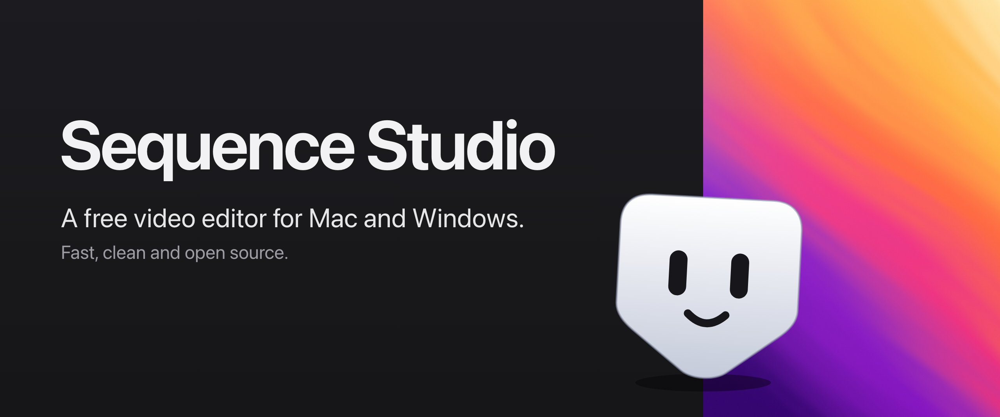

### The open-source video editor that stays out of your way.

Cut, grade, caption and export short-form video in one fast app. For Mac and Windows.<br>
**Open source (GPL-3.0). Build it yourself for free. No account, no subscription, no watermark.**

[](https://github.com/paulherter/sequence-studio/releases)
[](https://github.com/paulherter/sequence-studio/issues/new/choose)

[](LICENSE)


[Why](#-why-sequence-studio) &middot; [Features](#-features) &middot; [Install](#-install) &middot; [Status](#-status-alpha) &middot; [Formats](#formats) &middot; [Contributing](#contributing)

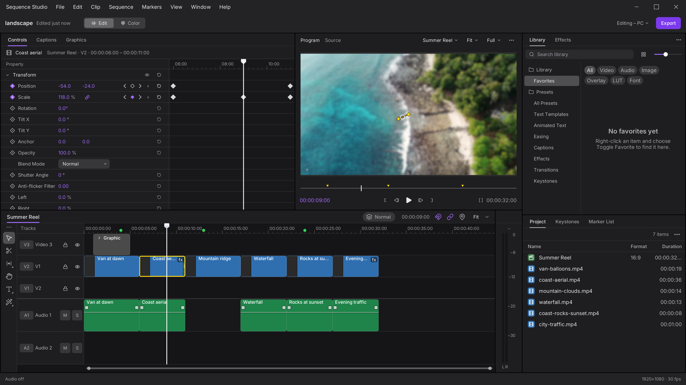

</div>

## ✨ Why Sequence Studio

- **Feels familiar.** A multi-track timeline, Source and Program monitors and Effect Controls, where you expect them.
  If you have edited before, you can start cutting right away.
- **Fast.** Written in Swift. On the Mac the picture is drawn with Metal and decoding is hardware accelerated; on
  Windows it is Direct3D 12 and FFmpeg. The editor stays responsive, also on smaller machines.
- **Uncluttered.** One tool per job, no panels you never open, no upsell. Panels dock, tab and float.
- **Made for short-form.** Rough cut, b-roll, titles, captions, a quick grade, export for vertical and widescreen.
- **One codebase.** The editor UI and engine logic are shared between macOS and Windows, so a feature is written once.
- **Open source.** The full source is under the GPL-3.0 and you can always build it yourself for free. Ready-made, signed installers and future extras may be paid; the editor itself stays open.

## 🎬 Features

<table>
<tr>
<td width="50%" valign="top">
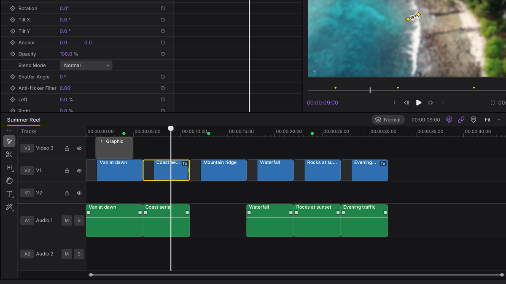<br>
<b>Timeline</b><br>
Multi-track editing with ripple, roll, slip and slide trims, insert and overwrite, razor, markers, nested sequences,
undo for everything and autosave. <b>Fast Cut</b> sequences add a magnetic mode where every edit closes gaps for you.
</td>
<td width="50%" valign="top">
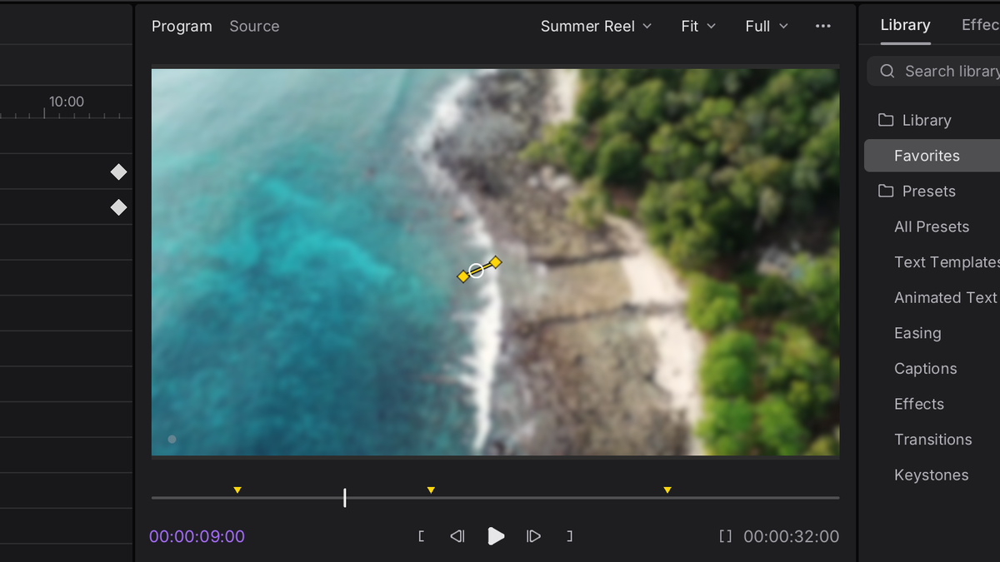<br>
<b>Playback</b><br>
Hardware decoding, frame cache and prefetch, proxy generation for heavy footage, and GPU compositing that matches
the export. Monitors can float as their own windows. An optional guide draws a platform UI mock over the Program
monitor.
</td>
</tr>
<tr>
<td width="50%" valign="top">
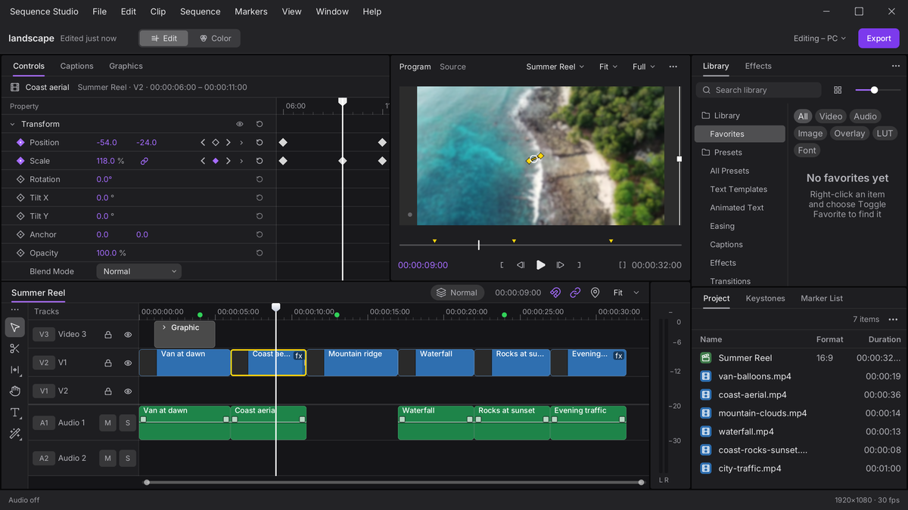<br>
<b>Effects and motion</b><br>
Transform with keyframes and curves, blurs, drop and long shadows, outline, trails, transitions, speed changes and
Lottie animations. Quick Apply puts a favorite effect or preset on the selected clip from a search popup.
</td>
<td width="50%" valign="top">
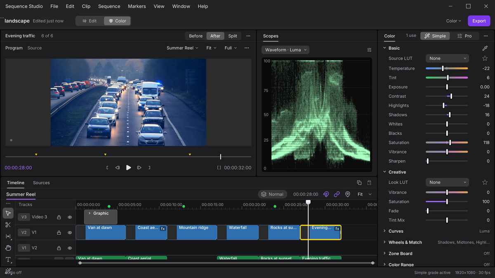<br>
<b>Color</b><br>
Grading with scopes and LUTs, and Match Color, which matches one clip to the look of another.
</td>
</tr>
<tr>
<td width="50%" valign="top">
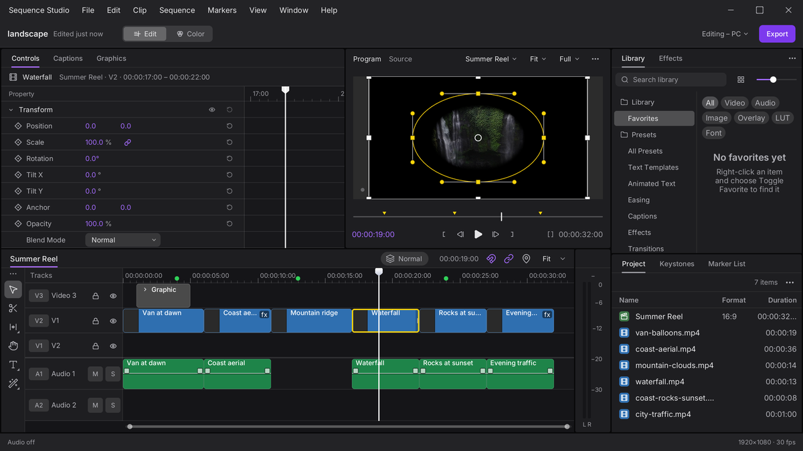<br>
<b>Masks, tracking and analysis</b><br>
Shape masks, picture (matte) masks, Magic Mask (click a subject, then track it), point and mask tracking,
stabilization, auto reframe and scene-change detection. Gyro-based stabilization uses
<a href="https://github.com/gyroflow/gyroflow">Gyroflow</a> (optional, Mac). On Windows, Magic Mask and scene
detection are wired up; stabilization and auto reframe are not available yet.
</td>
<td width="50%" valign="top">
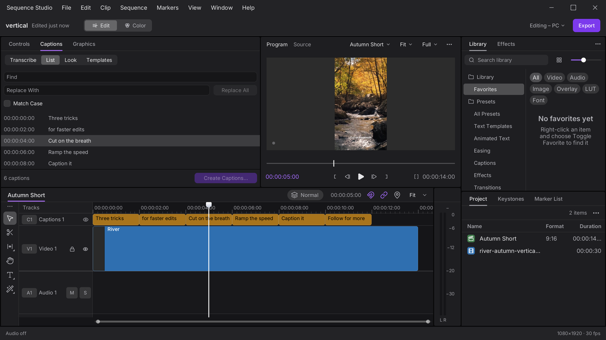<br>
<b>Titles and captions</b><br>
Text layout with bundled open fonts, caption styles, on-device speech transcription (Apple speech on the Mac,
<a href="https://github.com/ggml-org/whisper.cpp">whisper.cpp</a> on Windows) and subtitle import. Premiere-authored
<code>.mogrt</code> templates can be imported as title templates.
</td>
</tr>
<tr>
<td width="50%" valign="top">
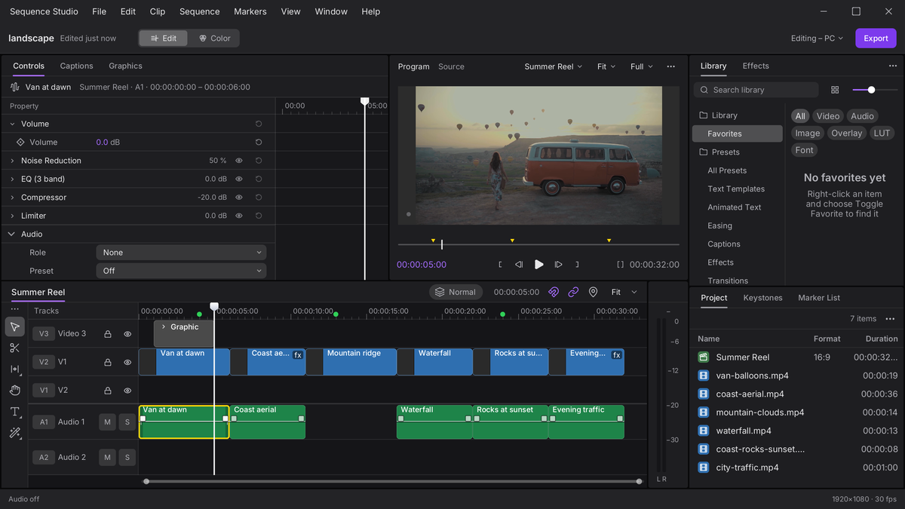<br>
<b>Audio</b><br>
Per-track and per-clip effects, noise suppression, silence removal, ducking, loudness normalization on export.
</td>
<td width="50%" valign="top">
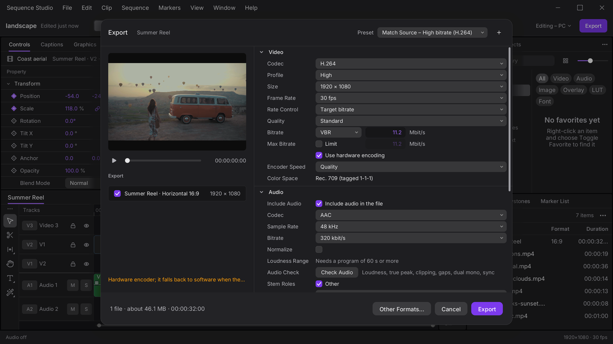<br>
<b>Export</b><br>
A queue with progress, presets for common social formats, smart rendering where possible and an optional
sidecar <code>.srt</code>. ProRes is Mac only.
</td>
</tr>
</table>

Also in the box: a start window with recents, 9:16 and 16:9 starting points and templates; Premiere Pro project and
effect preset import (experimental, the import report lists what was skipped); Lottie and `.mogrt` import; and an
optional local HTTP/MCP edit API so scripts and agents can read and edit the open project (off by default, see
[docs/EDIT-API.md](docs/EDIT-API.md)).

<div align="center">
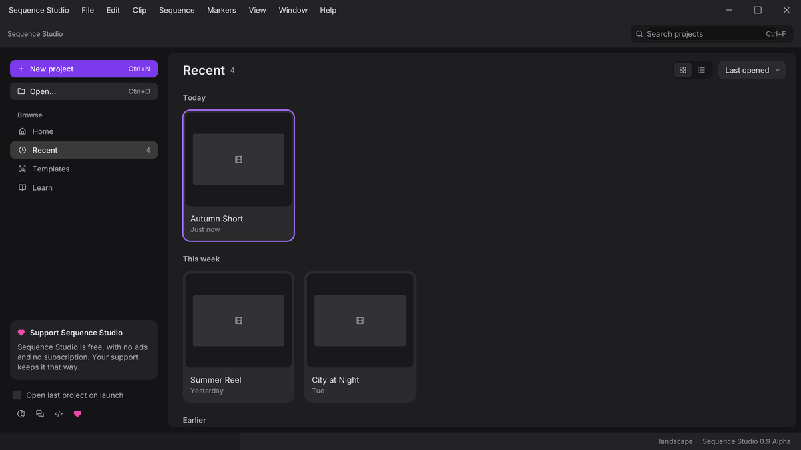
</div>

## 📦 Install

**Mac:** download the latest `.dmg` from the [Releases](https://github.com/paulherter/sequence-studio/releases) page and
drag Sequence Studio to Applications. You need a Mac with Apple Silicon and macOS 26 or later. Release builds are
Developer ID signed and notarized. If a build is only ad-hoc signed (the release notes say so), right-click the app,
choose **Open** and confirm once.

**Windows:** a Windows 10/11 x64 build comes with the release; until an installer is published you can build it from
source, see [Build from source](#build-from-source).

**Free or paid?** The source code is free and open (GPL-3.0): anyone can build and use it at no cost. Convenience
builds (the signed and notarized `.dmg`, Windows installer, automatic updates) and later extras may be offered for a
price or on a pay-what-you-want basis to fund development. What that looks like is not decided yet.

## 🚧 Status: Alpha

Sequence Studio is alpha software. It already does a lot, but most of it has had limited hands-on testing, so expect
rough edges. Project files may change between versions: keep backups and do not use it for paid work yet.

**Mac and Windows share one app.** The editor UI (timeline, monitors, inspector, color, text, library, dialogs) is
drawn by shared code (`SQDraw*`, `SQAppShell`, `SQEditorSession`); only the media, GPU, audio and window backends differ
per platform. On the Mac the AppKit UI is still the default and the shared app is opt-in (`SQ_SHARED_UI=1`, see
`scripts/run-shared.sh`); Windows only runs the shared app. A command audit of the two is in
[docs/FEATURE-PARITY.md](docs/FEATURE-PARITY.md).

**Works today**

- Timeline editing, Fast Cut magnetic sequences, undo, autosave, nested sequences, markers, floating panels.
- Playback with hardware decoding, caches and proxies, with the same compositor as the export.
- Effects, keyframes and curves, transitions, speed, Quick Apply, Lottie clips, masks, Magic Mask, tracking, stabilization.
- Color grading with scopes, LUTs and Match Color, titles, captions, on-device transcription, audio effects.
- Export queue with social presets, H.264 and HEVC (and ProRes on the Mac), loudness normalization.
- Premiere Pro project import, `.mogrt` template import, local edit API.

**Not there yet**

- Windows (x86-64, Direct3D 12) is a first alpha for developers: it runs the shared app on FFmpeg media, with Magic
  Mask and whisper.cpp captions, but there is no installer or updater, no ProRes, no HDR, no Gyroflow, stabilization or
  auto reframe, and some commands answer "not available in this window yet". Much of it was verified by tests and
  headless runs, not yet by long hands-on use.
- No Intel Mac, Windows on ARM or Linux.
- Premiere import covers a subset of effects and project features.
- Plugin support and a node-based color mode are not started.

Found a bug or missing something? [Open an issue](https://github.com/paulherter/sequence-studio/issues/new/choose). Feedback shapes what gets built next.

## Formats

| | |
|---|---|
| Import (video) | iPhone HEVC (SDR and HDR/HLG), H.264, camera footage such as Sony XAVC (S-Log3), ProRes, `.mkv` and `.webm` (HDR on Windows is not done) |
| Import (other) | Still images, animated PNG, Lottie, subtitle files, Premiere Pro projects, `.mogrt` templates |
| Export | H.264, HEVC, ProRes (422, 422 HQ, 4444; Mac only), with presets for social formats |

## Build from source

**Mac:** you need Xcode 26 and [XcodeGen](https://github.com/yonaskolb/XcodeGen) (`brew install xcodegen`).

```sh
xcodegen generate
scripts/build.sh            # builds the app, prints errors only
scripts/run-shared.sh       # builds, then starts the app on the shared UI (the Windows code path)
scripts/test.sh [Package]   # tests one package, or all
scripts/check.sh            # tests the packages your change touches, UI lint, app build
```

**Windows:** the app lives in `Windows/SQWinApp` and builds with SwiftPM (Swift 6 for Windows, an FFmpeg LGPL shared
build in `SQ_FFMPEG`). Optional runtime pieces: whisper.cpp for captions (`scripts/win-whisper-setup.sh`) and ONNX
Runtime for Magic Mask (`scripts/win-onnx-setup.sh`). The portable packages test on Windows with
`scripts/win-test.sh <Package> build|test`; `scripts/win-app.sh` builds and runs the app on a Windows PC driven from a
Mac.

Optional: `scripts/build-gyro.sh` builds the Rust Gyroflow engine (needs a Rust toolchain). Without it the app
works; only the Gyroflow stabilization method is unavailable. Test footage is not in the repository: put your own
under `TestMedia/` (git-ignored). More in [CONTRIBUTING.md](CONTRIBUTING.md).

<details>
<summary>Packages</summary>

The engine is split into Swift packages under `Packages/`; `App/` is the Mac app shell, `Windows/SQWinApp` the
Windows app and `Tools/` holds development executables.

| Package | Purpose |
|---|---|
| SQCore | Project model, rational time, timeline edit logic, undo snapshots, project file, autosave. No AVFoundation or AppKit. |
| SQMedia | Media import and probing, demuxing, video and audio decoding, thumbnails, relink. |
| SQRender | Metal compositor, effects and presenter. |
| SQPlayback | Playback clock, frame cache, prefetch, decode scheduling, audio engine. |
| SQExport | Export settings, frame source, writer, loudness normalization. |
| SQAudioFX | Audio effects, including noise suppression (RNNoise). |
| SQAnalysis | Stabilization (including Gyroflow), tracking, Magic Mask, scene detection, reframing. |
| SQProxy | Proxy media generation and cache. |
| SQLibrary | Media library: bins, folder watching, search. |
| SQText | Text layout, titles and bundled fonts. |
| SQTranscribe | Speech transcription (Apple speech, whisper.cpp), captions and subtitle files. |
| SQLottie | Lottie rendering (ThorVG). |
| SQPremiereImport | Reader and mapper for Premiere Pro projects and effect presets. |
| SQEditAPI | Local edit API server for scripts and agents. |
| SQEditorUI | Theme, panel layout, timeline and monitor views of the AppKit app. |
| SQUIKit, SQTimelineUI, SQMonitorUI, SQInspectorUI | AppKit controls and panels (design tokens, icons, timeline, monitors, inspector). |
| SQDrawKit | Portable draw-list UI toolkit: canvas, glyph atlas, controls and renderers (CoreGraphics, Metal, D3D12, software). |
| SQDrawShell, SQDrawTimeline, SQDrawMonitor, SQDrawLibrary | Shared panels drawn with SQDrawKit: menus and dialogs, timeline, monitors, Project and Effects libraries. |
| SQEditorSession | Portable editor session: commands, selection, tools, analysis flows. |
| SQAppShell | The shared app shell and panel hosts both platforms run. |
| SQFrame, SQGPU, SQGPUD3D12 | Neutral frame type, GPU backend protocol (shaders in Slang) and the Direct3D 12 backend. |
| SQMediaFFmpeg | FFmpeg demuxing, decoding and export encoding (Windows). |
| SQOnnx | ONNX Runtime wrapper for subject masks (Windows). |
| TestSupport | Shared helpers for tests (timing). |

</details>

## Contributing

Issues and pull requests are welcome, in English. Please open an issue before starting larger work. Read
[CONTRIBUTING.md](CONTRIBUTING.md) and the [Code of Conduct](CODE_OF_CONDUCT.md) first. Security problems: see
[SECURITY.md](SECURITY.md). Questions and ideas are welcome as issues.

## License and credits

GPL-3.0-or-later, see [LICENSE](LICENSE). Every binary release links the source tag it was built from.
Third-party code, fonts and libraries with their licenses are listed in [docs/THIRD_PARTY.md](docs/THIRD_PARTY.md),
among them Gyroflow (GPL-3.0), ThorVG (MIT), RNNoise (BSD-3-Clause) and the bundled OFL fonts.

Sequence Studio is an independent project. Not affiliated with Adobe; Premiere Pro is a trademark of Adobe. Other
product names are trademarks of their owners and are used for identification only.

Built with help from [Claude](https://claude.com/claude-code), Anthropic's coding assistant.
