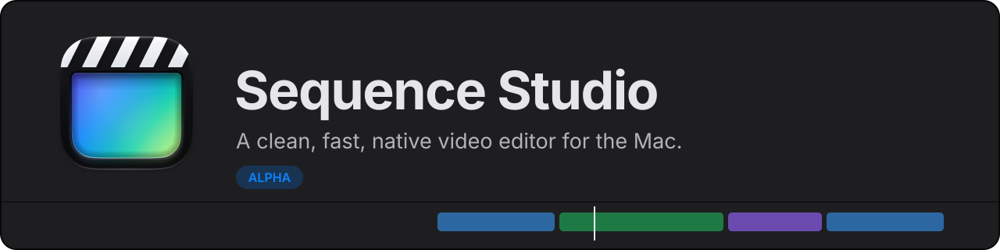
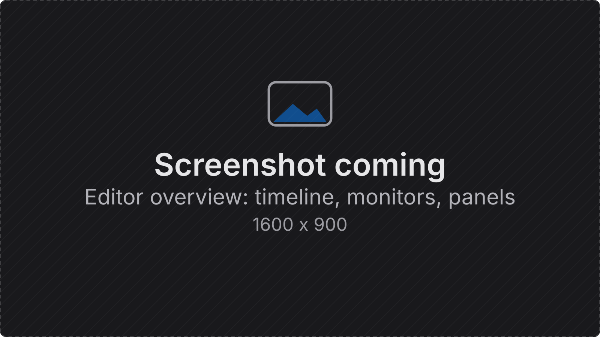
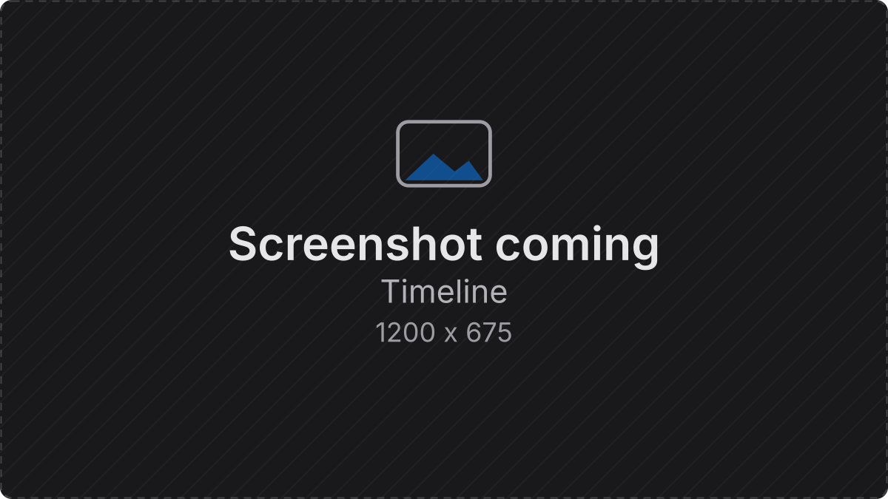
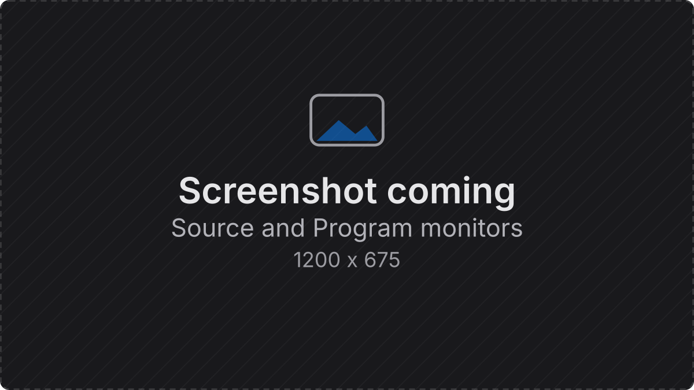
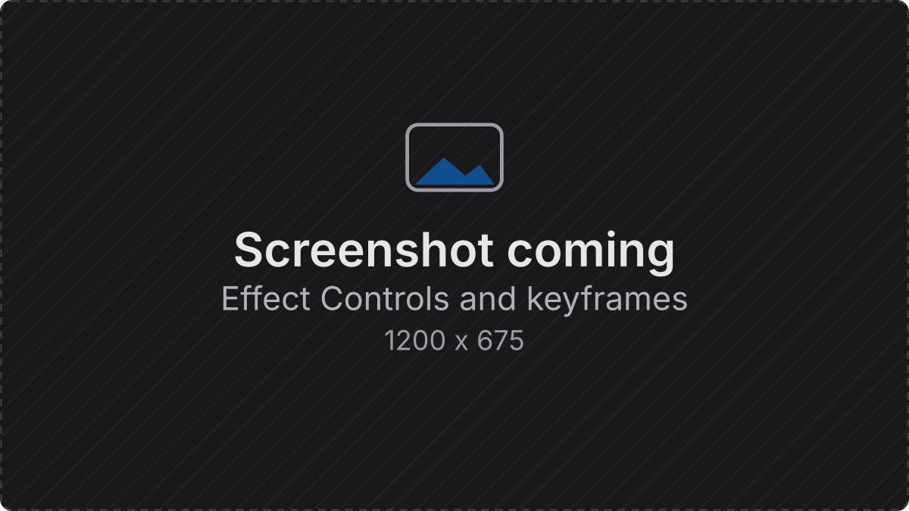
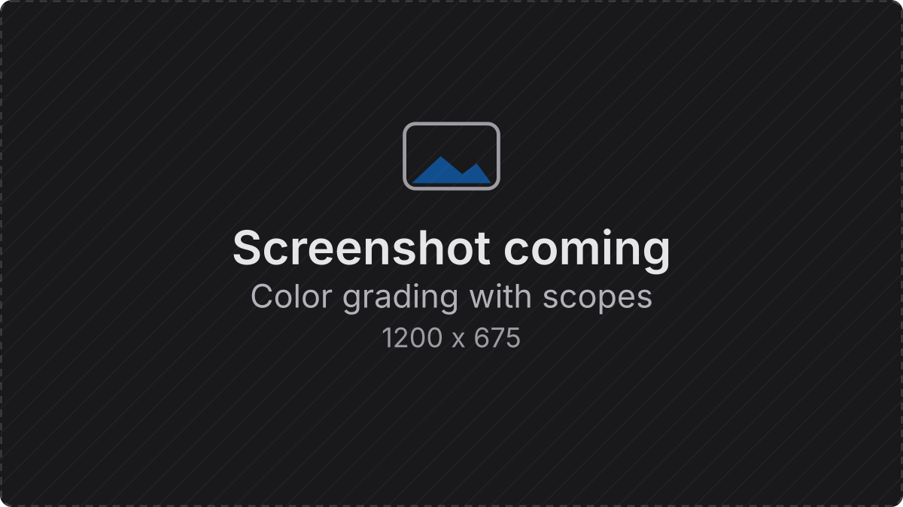
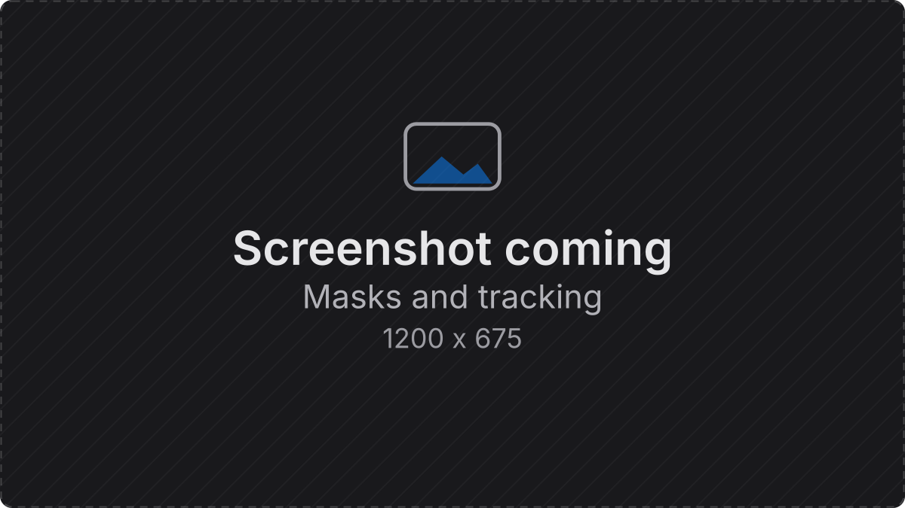
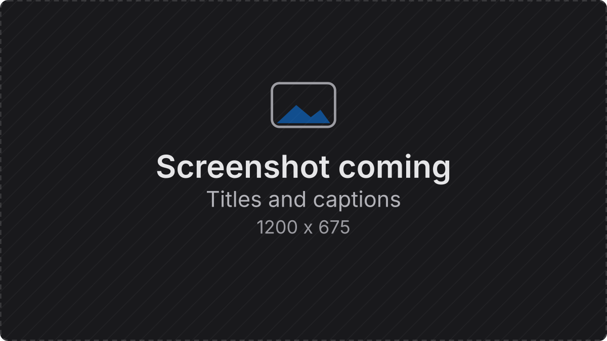
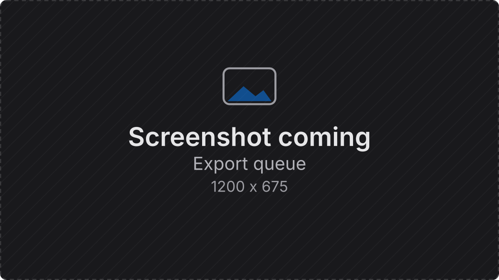
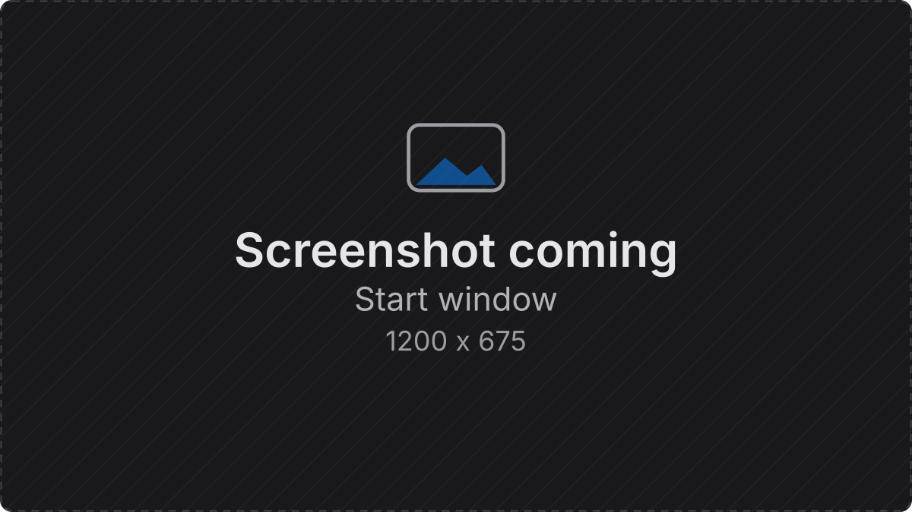

<div align="center">

<picture>
  <source media="(prefers-color-scheme: dark)" srcset="docs/readme/banner-dark.svg">
  <source media="(prefers-color-scheme: light)" srcset="docs/readme/banner-light.svg">
  
</picture>

### The free video editor for the Mac that stays out of your way.

Cut, grade, caption and export short-form video in one fast, native app.<br>
**Free. Open source. No account, no subscription, no watermark.**

[](https://github.com/paulherter/sequence-studio/releases)
[](https://github.com/sponsors/paulherter)
[](DISCORD_INVITE_URL)
[](https://github.com/paulherter/sequence-studio/issues/new/choose)

[](LICENSE)


[Why](#-why-sequence-studio) &middot; [Features](#-features) &middot; [Install](#-install) &middot; [Status](#-status-alpha) &middot; [Formats](#formats) &middot; [Support](#-support-the-project) &middot; [Contributing](#contributing)



</div>

## ✨ Why Sequence Studio

- **Feels familiar.** A multi-track timeline, Source and Program monitors and Effect Controls, where you expect them.
  If you have edited before, you can start cutting right away.
- **Fast.** Written in Swift for Apple Silicon. The picture is drawn with Metal and decoding is hardware accelerated,
  so the editor stays responsive, also on smaller Macs.
- **Uncluttered.** One tool per job, no panels you never open, no upsell.
- **Made for short-form.** Rough cut, b-roll, titles, captions, a quick grade, export for vertical and widescreen.
- **Free for everyone.** No paid tier and no locked features. The source is open under the GPL-3.0.

## 🎬 Features

<table>
<tr>
<td width="50%" valign="top">
<br>
<b>Timeline</b><br>
Multi-track editing with ripple, roll, slip and slide trims, insert and overwrite, razor, markers, nested sequences,
undo for everything and autosave. <b>Fast Cut</b> sequences add a magnetic mode where every edit closes gaps for you.
</td>
<td width="50%" valign="top">
<br>
<b>Playback</b><br>
Hardware decoding, frame cache and prefetch, proxy generation for heavy footage, and Metal compositing that matches
the export. An optional guide draws a platform UI mock over the Program monitor.
</td>
</tr>
<tr>
<td width="50%" valign="top">
<br>
<b>Effects and motion</b><br>
Transform with keyframes and curves, blurs, drop and long shadows, outline, trails, transitions, speed changes and
Lottie animations.
</td>
<td width="50%" valign="top">
<br>
<b>Color</b><br>
Grading with scopes, LUTs and automatic color matching between clips.
</td>
</tr>
<tr>
<td width="50%" valign="top">
<br>
<b>Masks and tracking</b><br>
Shape masks, picture (matte) masks, subject masks, point and mask tracking, and stabilization, including optional
gyro-based stabilization powered by <a href="https://github.com/gyroflow/gyroflow">Gyroflow</a>.
</td>
<td width="50%" valign="top">
<br>
<b>Titles and captions</b><br>
Text layout with bundled open fonts, caption styles, on-device speech transcription and subtitle import.
Premiere-authored <code>.mogrt</code> templates can be imported as title templates.
</td>
</tr>
<tr>
<td width="50%" valign="top">
<br>
<b>Audio</b><br>
Per-track and per-clip effects, noise suppression, voice and ducking tools, loudness normalization on export.
</td>
<td width="50%" valign="top">
<br>
<b>Export</b><br>
A queue with progress, presets for common social formats, smart rendering where possible and an optional
sidecar <code>.srt</code>.
</td>
</tr>
</table>

Also in the box: a start window with recents, 9:16 and 16:9 starting points and templates; Premiere Pro project and
effect preset import (experimental, the import report lists what was skipped); and an optional local HTTP/MCP edit API
so scripts and agents can read and edit the open project (off by default, see [docs/EDIT-API.md](docs/EDIT-API.md)).

<div align="center">

</div>

## 📦 Install

1. Download the latest `.dmg` from the [Releases](https://github.com/paulherter/sequence-studio/releases) page.
2. Open it and drag Sequence Studio to Applications.

You need a Mac with Apple Silicon and macOS 26 or later. Release builds are Developer ID signed and notarized.
If a build is only ad-hoc signed (the release notes say so), right-click the app, choose **Open** and confirm once.

## 🚧 Status: Alpha

Sequence Studio is alpha software. It already does a lot, but most of it has had limited hands-on testing, so expect
rough edges. Project files may change between versions: keep backups and do not use it for paid work yet.

**Works today**

- Timeline editing, Fast Cut magnetic sequences, undo, autosave, nested sequences, markers.
- Playback with hardware decoding, caches and proxies, with the same compositor as the export.
- Effects, keyframes and curves, transitions, speed, Lottie clips, masks, tracking, stabilization.
- Color grading with scopes and LUTs, titles, captions, on-device transcription, audio effects.
- Export queue with social presets, H.264, HEVC and ProRes output, loudness normalization.
- Premiere Pro project import, `.mogrt` template import, local edit API.

**Not there yet**

- Apple Silicon and macOS 26 only: no Intel, Windows or Linux.
- Premiere import covers a subset of effects and project features.
- Plugin support and a node-based color mode are not started.

Found a bug or missing something? [Open an issue](https://github.com/paulherter/sequence-studio/issues/new/choose)
or tell us on [Discord](DISCORD_INVITE_URL). Feedback shapes what gets built next.

## Formats

| | |
|---|---|
| Import (video) | iPhone HEVC (SDR and HDR/HLG), H.264, camera footage such as Sony XAVC (S-Log3), ProRes, `.mkv` and `.webm` |
| Import (other) | Still images, animated PNG, Lottie, subtitle files, Premiere Pro projects, `.mogrt` templates |
| Export | H.264, HEVC, ProRes (422, 422 HQ, 4444), with presets for social formats |

## 💜 Support the project

Sequence Studio is free and stays free. Nothing is locked behind a payment, and that will not change.

If the app saves you time or money, you can give something back through
[GitHub Sponsors](https://github.com/sponsors/paulherter):

- **Monthly**, from the price of a coffee. A few dollars a month from many people is what keeps a free editor alive.
- **One time**, any amount, whenever you feel like it.

What your support does:

- Pays for development time, so new features and fixes arrive faster.
- Covers the running costs: Apple developer membership for signed builds, test hardware and tools.
- Keeps the app free for people who cannot pay.

As a thank you, supporters are listed by name in this README and in the app's About window (only if you want that).
Supporting gives no special rights and is not a tax-deductible payment.

<div align="center">

[](https://github.com/sponsors/paulherter)

</div>

No budget? A star on this repository, a bug report or telling another editor about it helps just as much.

## Build from source

You need Xcode 26 and [XcodeGen](https://github.com/yonaskolb/XcodeGen) (`brew install xcodegen`).

```sh
xcodegen generate
scripts/build.sh            # builds the app, prints errors only
scripts/test.sh [Package]   # tests one package, or all
```

Optional: `scripts/build-gyro.sh` builds the Rust Gyroflow engine (needs a Rust toolchain). Without it the app
works; only the Gyroflow stabilization method is unavailable. Test footage is not in the repository: put your own
under `TestMedia/` (git-ignored). More in [CONTRIBUTING.md](CONTRIBUTING.md).

<details>
<summary>Packages</summary>

The engine is split into Swift packages under `Packages/`; `App/` is the SwiftUI shell and `Tools/` holds
development executables.

| Package | Purpose |
|---|---|
| SQCore | Project model, rational time, timeline edit logic, undo snapshots, project file, autosave. No AVFoundation or AppKit. |
| SQMedia | Media import and probing, demuxing, video and audio decoding, thumbnails, relink. |
| SQRender | Metal compositor, effects and presenter. |
| SQPlayback | Playback clock, frame cache, prefetch, decode scheduling, audio engine. |
| SQExport | Export settings, frame source, writer, loudness normalization. |
| SQAudioFX | Audio effects, including noise suppression (RNNoise). |
| SQAnalysis | Stabilization (including Gyroflow), tracking, subject masks, reframing. |
| SQProxy | Proxy media generation and cache. |
| SQLibrary | Media library: bins, folder watching, search. |
| SQText | Text layout, titles and bundled fonts. |
| SQTranscribe | Speech transcription, captions and subtitle files. |
| SQLottie | Lottie rendering (ThorVG). |
| SQPremiereImport | Reader and mapper for Premiere Pro projects and effect presets. |
| SQEditAPI | Local edit API server for scripts and agents. |
| SQEditorUI | Theme, panel layout, timeline and monitor views. |
| TestSupport | Shared helpers for tests (timing). |

</details>

## Contributing

Issues and pull requests are welcome, in English. Please open an issue before starting larger work. Read
[CONTRIBUTING.md](CONTRIBUTING.md) and the [Code of Conduct](CODE_OF_CONDUCT.md) first. Security problems: see
[SECURITY.md](SECURITY.md). Questions and ideas are welcome on [Discord](DISCORD_INVITE_URL).

## License and credits

GPL-3.0-or-later, see [LICENSE](LICENSE). Every binary release links the source tag it was built from.
Third-party code, fonts and libraries with their licenses are listed in [docs/THIRD_PARTY.md](docs/THIRD_PARTY.md),
among them Gyroflow (GPL-3.0), ThorVG (MIT), RNNoise (BSD-3-Clause) and the bundled OFL fonts.

Sequence Studio is an independent project. Not affiliated with Adobe; Premiere Pro is a trademark of Adobe. Other
product names are trademarks of their owners and are used for identification only.

Built with help from [Claude](https://claude.com/claude-code), Anthropic's coding assistant.
