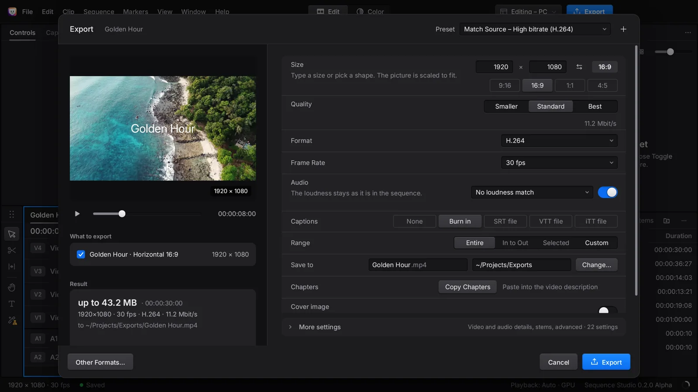

## For users

Render your sequence to a file: presets, the export queue, smart rendering, captions and delivery targets.

### Export a video

1. Choose File > Export… (Command-M on the Mac, Ctrl+M on Windows and Linux).
2. Pick a preset at the top right of the sheet.
3. Check **Size**, **Quality**, **Format** and **Frame Rate**. The panel on the left shows the result and the estimated file size.
4. Under **Save to** type the file name and, with **Change…**, pick the folder.
5. Click **Export**. The job goes into the export queue.

The sheet opens at the size and shape of your sequence. If the preset it starts with (your last one, or the one that belongs to the sequence's delivery target) is made for another shape, such as YouTube 1080p on a vertical sequence or TikTok on a horizontal one, the size stays the sequence's own and the picture is not letterboxed. When you pick a preset yourself in the sheet, you get that preset's own size.

For a fast export with no dialog, use Quick Export (Option-Command-M, Windows and Linux Ctrl+Alt+M). It uses the sequence's platform preset and the last export folder (or the Movies folder on the Mac, the Videos folder on Windows and Linux, if there is none).

### Presets

| Group | Presets |
|---|---|
| Match Source | Match Source – High bitrate (H.264), Match Source – HEVC 10-bit, Best quality at size – H.264 (multi-pass) |
| YouTube | YouTube 1080p Full HD, YouTube 1440p QHD, YouTube 4K Ultra HD |
| Other sites | X (Twitter) 1080p (H.264), Facebook 1080p (H.264) |
| Short video | TikTok 1080×1920, Instagram Reels 1080×1920, YouTube Shorts 1080×1920 (H.264 or HEVC) |
| Instagram | Instagram Feed 4:5 1080×1350, Instagram Feed 1:1 1080×1080, Instagram Stories 1080×1920 |
| Master | ProRes 422 HQ, ProRes 422, ProRes 4444 |
| Audio only | M4A (AAC), WAV (24-bit PCM), FLAC (lossless) |
| Other | Animated GIF, Image sequence (PNG) |

The top card holds what almost every export needs: Size (type a width and height, swap them with the arrows, or pick 9:16, 16:9, 1:1 or 4:5), Quality (Smaller, Standard or Best, with the bitrate beside it; a step keeps the preset you picked and is remembered with it, while typing a bitrate, codec, size or frame rate yourself turns the preset into Custom), Format, Frame Rate, Audio, Captions, Range and Save to. The Result block on the left shows the estimated file size, the length and the target file. Everything technical is folded under More settings: Video details (profile, rate control, bitrate, hardware encoding, encoder speed, color space), Audio details and Advanced. Range exports the Entire sequence, In to Out, a Custom range, or the Selected clips, with an option for one file per clip. When the sequence has In/Out marks, an In / Out line shows the range the picked mode exports (Entire reads from the start to the end of the sequence).

HEVC, H.264 and ProRes are offered on all three systems. H.264 and HEVC use a hardware encoder when your computer has one and software otherwise. ProRes uses the Mac's hardware encoder when it is available; on Windows and Linux it is made in software.

### Delivery targets

A sequence can have a delivery target: TikTok, Reels, Shorts, a social feed post or YouTube. The target picks the matching export preset and the loudness (-14 LUFS, -1 dBTP true peak). With no target, the default is Match Source. For YouTube the preset follows the frame width: 1080p, 1440p or 4K. The target never changes the size of the sheet: a vertical sequence with a YouTube target still opens vertical.

### The export queue

Every export goes into the queue, so you can keep editing. Open the Export Queue (its header shows the job count, such as "3 jobs") to see each job as Waiting, Exporting, Done, Failed (with the reason) or Canceled. You can cancel a waiting or running job (stopping a running export asks first, and the unfinished file is deleted), reveal a finished file (Reveal in Finder on the Mac, Show in Explorer on Windows, Show in File Manager on Linux), and use Clear Finished. In a small window a long queue scrolls instead of running out of the window, so its header and its footer (Stop All, Clear Finished) stay in view.

### Captions with your video

In the Captions section choose None, Burn in, SRT file, VTT file or iTT file. SRT, VTT and iTT save a sidecar file next to the video, with the same name. Burn in draws the captions into the picture.

### Audio, cover and chapters

- Audio: Include Audio, Sample Rate (44.1, 48 or 96 kHz), Bit Depth, Channels, Normalize, Loudness Range, True Peak Max.
- Also save cover image: saves a PNG, with a Cover Frame you choose.
- Copy Chapters puts chapter text on the clipboard, to paste into a video description.
- Export Cut-downs and Export Stems are in the same sheet for extra files.

### Advanced

Keyframe Every, B-Frames, Alpha (Keep transparency, ProRes 4444), Damaged Frames (continue on damaged frames), HDR to SDR, HDR Gamut, Color Space and Peak Brightness. H.264 is tagged Rec. 709. "Also export every format variant" makes all variants in one go.

Settings > Media has "Use proxies when exporting". It is off by default and is meant for drafts only.

### Other formats

File also offers Export EDL…, FCPXML…, OpenTimelineIO… and Markers as CSV….

### Export a single frame
**File > Export Frame** (Shift+E) saves the picture the Program monitor (or the Source monitor) shows as a still, at the full size of the sequence whatever the monitor quality is. The save panel's format list offers PNG, JPEG, TIFF (16-bit) and EXR (half float, linear); the file name suggested is the sequence name. PNG and JPEG are 8-bit, TIFF is 16-bit, all with the Rec.709 curve like the monitor; EXR keeps the linear light values. PNG and TIFF keep an alpha channel when the picture has transparent areas (turn on the transparency grid to see them); JPEG is always opaque, EXR always has alpha. JPEG uses quality 95. The PNG file is tagged Rec.709 (cICP chunk); TIFF, JPEG and EXR carry no color tag.

### Windows and Linux

HDR export (HEVC, PQ) works on Windows; it was checked on one PC. On Windows the hardware encoders tried are NVIDIA NVENC, AMD AMF, Intel Quick Sync and Windows Media Foundation, in that order; on Linux it is VA-API. They honor the bitrate (average or constant), 10-bit HEVC, Keyframe Every, the H.264 profile (Baseline, Main or High; a Baseline file has no B-frames) and, where the encoder has them, B-Frames. Without a hardware encoder H.264 is written by OpenH264 and HEVC by Kvazaar, both 8-bit; OpenH264 writes no B-frames, and neither does multi-pass. The sheet names the encoder that will run and marks what it cannot do as not available on this computer (for example the B-Frames box and the H.264 profile), instead of writing a file that ignores it. Your choice of format is never swapped for another: if no 10-bit HEVC encoder is available (Main 10, HDR), Main 10 is greyed out with "not available on this computer" and the export stops with a message that says what to choose instead (turn on hardware encoding, HEVC Main, H.264 or ProRes). The same holds for a computer with no H.264 or HEVC encoder at all; no MPEG-4 file is written in their place.

### Not sure yet

- Smart rendering (copying an untouched clip without re-encoding): the export core does not include it, so it is not described here.
- Where the Export Queue button sits in the window.
- Exact hardware encoder support on Windows and Linux, and whether HDR export works on Linux.
- Whether ProRes files made on Windows and Linux open in every other editor.
- Which HEVC color space choices appear for each preset.

Related: [Titles and Captions](text-and-subtitles.md), [Audio](audio.md), [Settings and Updates](settings-and-updates.md), [Troubleshooting](troubleshooting.md)

## For developers

### Crates and modules

`crates/sq-export/src` has three modules (`lib.rs`):

- `core`: portable settings and logic. `settings.rs` (`ExportSettings`, `VideoSettings`, `AudioSettings`, `CaptionMode`, `RangeSelection`), `preset.rs` (`ExportPreset`, `QualityStep`, `SequenceShape`, `ExportPreferences`, `SocialPlatform`), `queue.rs` and `queue_state.rs` (`ExportQueue`, `ExportJob`, the job state machine), `delivery.rs` (delivery checks), `loudness.rs` and `audio_delivery.rs`, `stems.rs`, `preflight.rs` (free-space verdict), `encoder_support.rs` (what this computer's encoder cannot do), `hdr.rs`, `traits.rs` (`FrameSource`, `AudioSource`, `ExportEncoding`).
- `encode`: the FFmpeg implementation. `encoder.rs` (`FfmpegExportEncoder`), `pipeline.rs` (a frame pump: rendering on its own thread, frames handed to the encoding thread through a bounded channel), `video.rs`, `audio.rs`, `audio_file.rs` (M4A, WAV, FLAC), `gif.rs`, `sequence.rs` (image sequences), `hdr_stage.rs` (Rec.2020 HLG or PQ as 10-bit P010), `verify.rs` (measures loudness and true peak of the written file).
- `formats`: text and interchange writers. `edl.rs` (CMX3600), `fcpxml.rs`, `xmeml.rs` (Final Cut Pro 7 XML), `otio.rs`, `subtitles.rs` (SRT, VTT, iTT), `marker_csv.rs`, `youtube_chapters.rs`.

### Data flow

1. The app (`crates/sequence-studio/src/export.rs`) builds an `ExportJob` from a project snapshot and enqueues it on `ExportQueue` (`enqueue`).
2. `run_all` runs on the export thread and takes waiting jobs one after another. The queue is a clonable handle over one mutex-guarded state machine; a job goes Waiting, Running, Cancelling or Done / Failed, and an invalid transition is rejected, not panicked (`queue_state.rs`).
3. The job renders through a `FrameSource` (the GPU render and readback of `sq-render` sit behind it) and an `AudioSource` into `FfmpegExportEncoder`, which writes the file. Cancel is checked per frame and a partial file is deleted.
4. Sidecar captions and cover stills go through `SidecarWriting` and `CoverWriting`. The idle-sleep lock is held by the app shell, not by the queue.
5. The headless path `--export` (`crates/sequence-studio/src/export_cli.rs`) uses the same pipeline as the sheet; `--list-presets` prints the presets.

Hardware encoders are tried first (VideoToolbox on the Mac; NVENC, AMF, Quick Sync and Media Foundation on Windows; VA-API on Linux), then x264 or x265, OpenH264 or Kvazaar in software, `prores_ks` for ProRes, AAC or PCM audio (`encode/mod.rs`). Smart rendering is not ported to this core: `core/mod.rs` records it as dropped by design.

### Extension points

- A new preset: add it in `core/preset.rs` and a test in `core/tests/preset_tests.rs`.
- A new interchange format: a writer in `formats/` re-exported from `formats/mod.rs`, with a test in `formats/tests.rs`.
- A new output kind: implement `ExportEncoding` (`core/traits.rs`).

### Tests

`cargo test -p sq-export`. Queue, preset, settings, loudness, stems and delivery tests are in `core/tests/`; encoder tests are in `encode/tests.rs` and `encode/proof_tests.rs`; writers in `formats/tests.rs`.

## For AI agents

- Input: `ExportJob` (settings, sources, range, optional cues and cover) via `ExportQueue::enqueue`. Output: the media file at the job's URL, plus optional sidecar caption file, cover PNG, stems.
- Job states (`ExportJobState`): Waiting, Running, Cancelling, Done(path), Failed(message), Cancelled. Transitions live only in `crates/sq-export/src/core/queue_state.rs`.
- Invariants: the chosen codec is never swapped for another (an unavailable encoder stops the export with a message); a canceled or failed job leaves no partial file; `core` has no OS code; time is rational; subtitle times use integer arithmetic (ms rounded to nearest, ties up); marker CSV text cells that would run as a spreadsheet formula are guarded.
- Interchange writers return text plus warnings and write with `write_to(path)`: EDL, FCPXML, xmeml, OTIO, marker CSV, YouTube chapters (needs at least three chapters of 10 s or more).
- Social presets: `SocialPlatform` = Tiktok, Reels, Shorts (`core/preset.rs`).
- Files: `crates/sq-export/src/core/queue.rs`, `.../core/settings.rs`, `.../core/preset.rs`, `.../encode/encoder.rs`, `crates/sequence-studio/src/export.rs`, `crates/sequence-studio/src/export_cli.rs`.
- Commands: `cargo test -p sq-export`. Headless export: `--export <out>` and `--list-presets`, with `--preset`, `--range`, `--hdr hlg|pq`, `--no-hardware`, `--entire`, `--overwrite` (parsed in `crates/sequence-studio/src/cli.rs`).
