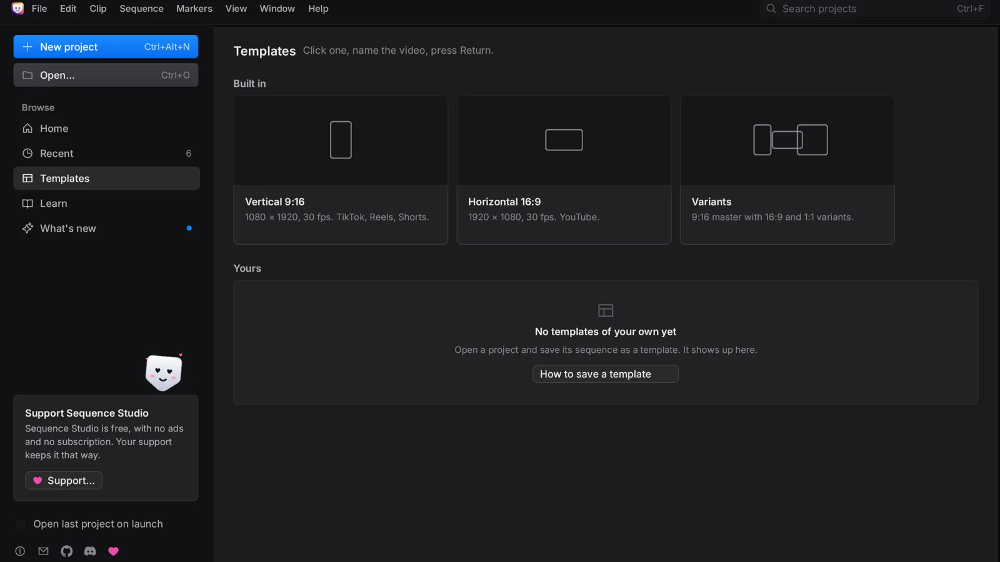
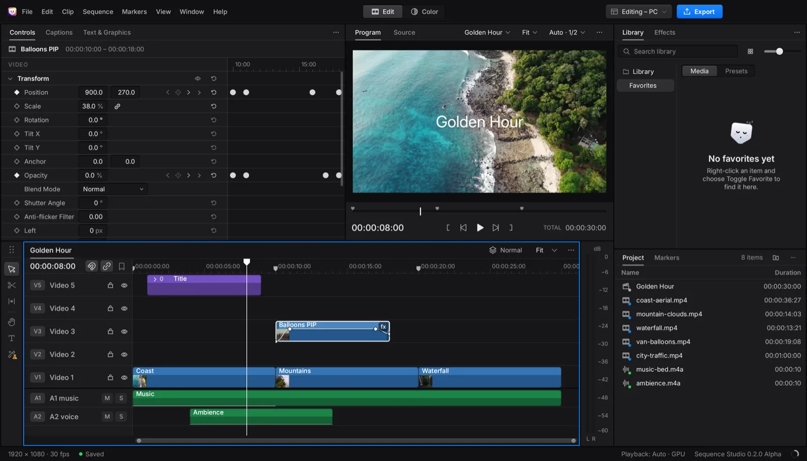

## For users

Install Sequence Studio, make your first project, bring in media and learn your way around the window. Follow the numbered steps in order the first time.

### Contents

1. [Install](#install)
2. [The start window](#the-start-window)
3. [Make your first project](#make-your-first-project)
4. [Import media](#import-media)
5. [A tour of the window](#a-tour-of-the-window)
6. [The menus](#the-menus)
7. [Saving and autosave](#saving-and-autosave)
8. [Undo, redo and History](#undo-redo-and-history)
9. [Settings you may want to know](#settings-you-may-want-to-know)
10. [Not sure yet](#not-sure-yet)

### Install

Sequence Studio is open source (GPL-3.0). During the alpha it is a free download. There is no account and no watermark.

#### Mac

You need a Mac with Apple Silicon and macOS 26 or later. Intel Macs are not supported.

1. Download `SequenceStudio-mac.dmg` from the [latest release](https://github.com/paulherter/sequence-studio/releases/latest).
2. Open the `.dmg`.
3. Drag **Sequence Studio** onto the **Applications** folder.
4. Open Sequence Studio from Applications.

The app is notarized by Apple, so it opens without a warning.

#### Windows

You need Windows 10 or 11 on a 64-bit (x64) PC. Some commands may answer "... is not available on this computer yet."

1. Download `SequenceStudio-windows-setup.exe` from the [latest release](https://github.com/paulherter/sequence-studio/releases/latest).
2. Run it. One window shows the folder (`%LOCALAPPDATA%\Programs\Sequence Studio`; **Change...** picks another) and a checkbox **Add to desktop**. Click **Install**. It installs for your user only and does not need administrator rights. It adds Sequence Studio to the Start menu and sets it as the app that opens `.sqproj` projects.
3. Click **Open Sequence Studio**, or start it later from the Start menu.

Running a newer installer over an installed version shows **Update Sequence Studio** and keeps your projects, settings, shortcuts and presets. To remove the app, use **Settings > Apps** (or the Start menu entry's Uninstall): it asks whether to delete the settings and caches too and never touches your projects and media.

The installer is not code-signed yet, so Windows may show a SmartScreen warning ("Windows protected your PC"): click **More info**, then **Run anyway**. See [Troubleshooting](troubleshooting.md).

#### Linux

You need a 64-bit (x86-64) Linux desktop with a Vulkan graphics driver. Sound goes through ALSA, PulseAudio or PipeWire.

One command in a terminal installs it for your user, with a menu entry:

```sh
curl -fsSL https://raw.githubusercontent.com/paulherter/sequence-studio/main/scripts/install.sh | sh
```

Or do it by hand:

1. Download `SequenceStudio-linux-x86_64.AppImage` from the [latest release](https://github.com/paulherter/sequence-studio/releases/latest).
2. Make it executable (in your file manager, or `chmod +x`).
3. Run it. Nothing is installed: the AppImage holds the app and everything it needs, FFmpeg included.

The first time you start it, Sequence Studio asks whether to add itself to your apps. **Add to App Menu** moves the AppImage to `~/Applications/SequenceStudio.AppImage` and puts a menu entry and the `.sqproj` file type into your user folder (`~/.local/share`); **Not Now** keeps it away. You can change your mind in **Settings > General > App menu**: **Add…** or **Remove…**. Remove takes out the menu entry and the `.sqproj` link, keeps your projects and settings, and can move the app file to the Trash. When you start a newer AppImage, the app offers to update the one in `~/Applications`; the old file goes to the Trash. **Voiceover from Text** needs the `espeak-ng` package from your distribution.

To check for a newer version, choose **Help > Check for Updates…**.

#### Keys on Mac, Windows and Linux

This manual shows the Mac key first and the Windows and Linux key second. Windows and Linux use the same keys.

| Mac | Windows and Linux |
|---|---|
| Command (Cmd) | Ctrl |
| Option | Alt |
| Shift | Shift |
| Delete | Backspace |
| Return | Enter |

### The start window

When you open the app you see the start window. It has a search field at the top and a rail on the left with **New project**, **Open…** and four tabs:



| Tab | What it shows |
|---|---|
| Home | Your newest project ("Continue"), and sizes to start from |
| Recent | Every project you opened lately. Sort by last opened, name or frame size |
| Templates | Built-in templates and your own saved templates |
| Learn | Short lessons: the keyboard map, templates, Fast Cut, outside files and more |

Things you can do here:

- Click a size tile or a template card to create a project in one click. The project is called "Untitled" (or the next free name) and is made in your projects folder.
- Drop a video file on the window. The new project takes that clip's size and frame rate.
- Right-click a recent project for **Open**, **Reveal in Finder** (Windows: **Show in Explorer**, Linux: **Show in File Manager**), **Remove from Recents** and **Remove All from Recents**.
- If a recent project's file is gone, it is grayed out. Choose **Locate…** to point to its new place. A project with missing media shows "N missing" in the list, next to a **Fix…** button.
- In Recent, press Tab to move to the grid/list toggle, then Left (grid) or Right (list); Esc leaves it.
- Hover **New project** to see its shortcut in the tooltip.

You can bring the start window back at any time with **Window > App Windows > Start Window**.

### Make your first project

#### How to make a project with the New project dialog

1. In the start window click **New project**. (In the editor use **File > New Project**, Option+Cmd+N / Ctrl+Alt+N.)
2. Type a **Name**.
3. Pick a **Template**, or keep the default.
4. Pick a **Frame size**. The list has three groups:
   - Social: Vertical video 1080 x 1920 (9:16), Portrait post 1080 x 1350 (4:5), Square 1080 x 1080, Portrait 3:4 1080 x 1440.
   - Wide: HD 1080p, 4K UHD, HD 720p.
   - Cinema: Ultrawide 21:9, Scope 2.39:1, DCI 4K.
   - Or choose **Custom size**.
5. Pick a **Frame rate** and the **Audio** setting.
6. Under **Timeline** choose **Normal** or **Fast Cut**. See [Editing](timeline-and-editing.md) for the difference. The default comes from **Settings > Editing**.
7. Under **Outside files** choose what happens to files that live outside the project folder: **Ask each time**, **Copy into project**, **Move into project** or **Leave in place**.
8. Click **Choose…** next to **Location** if you want another folder.
9. Click **Create**.

You can change the format later in **Sequence > Sequence Settings…**.

On macOS and Linux a project is a folder with the extension `.sqproj`; on Windows it is one `.sqproj` file.

#### Make a new sequence

A project can hold many sequences. Choose **File > New Sequence…** (Cmd+N / Ctrl+N).

### Import media

#### How to import files

1. Choose **File > Import…** (Cmd+I / Ctrl+I).
2. Pick one or more files.
3. The files appear in the **Project** panel.

Or drag files from Finder (Explorer on Windows, your file manager on Linux) straight into the Project panel.

What you can import:

- Video: iPhone HEVC (SDR and HDR/HLG), H.264, camera files such as Sony XAVC (S-Log3), ProRes, `.mkv` and `.webm`.
- Still images and animated PNG.
- Lottie animations and subtitle files.
- Premiere Pro projects and `.mogrt` templates (experimental).

#### Where do imported files live?

Files that are already inside the project folder are used where they are. For files from outside, the **Outside files** choice decides. You can change it for one project in **File > Media Management**, or for all projects in **Settings > Media**.

- **Ask each time** shows a question after the clips have landed in the project: **Copy into project**, **Move into project** or **Leave where it is**. Tick **Always do this in this project** to stop asking.
- **Copy into project** puts a copy in the project's `Files/Imported` folder and the clips use the copy. The original stays.
- **Move into project** does the same and sends the original to the Trash after the next save.
- **Leave in place** keeps using the file where it is.
- Files you add from a Library folder are copied into `Files/Library` and never asked about.

Other helpful commands in the **File** menu:

- **Collect Files into Project Folder** gathers the files the project uses into its project folder.
- **File > Project > Reconnect Media…** helps when files moved. Clips with missing files show as offline.
- **Media Management > Watch Project Folder** adds new files in the project folder to the Project panel by themselves.

#### Put a clip on the timeline

1. Click a clip in the Project panel.
2. Drag it onto the timeline.

You can also right-click a clip in the Project panel and choose **Open in Source**, mark a part with I and O, and press `,` (Insert) or `.` (Overwrite). More in [Editing](timeline-and-editing.md).

### A tour of the window

Sequence Studio has a set of panels. Each panel is a tab you can move, resize or pull out into its own window (on all three systems). The panels are listed in the **Window** menu.



| Panel | What it is for | Focus key (Mac / Windows and Linux) |
|---|---|---|
| Project | Your media, folders and sequences | Shift+1 |
| Source | Preview a clip and mark In and Out before editing it in | Shift+2 |
| Timeline | Where you build the video | Shift+3 |
| Tools | The tool strip left of the timeline | menu |
| Program | Shows the sequence at the playhead | Shift+4 |
| Controls | Effects, motion and keyframes of the selected clip (Effect Controls) | Shift+5 |
| Audio Meters | Sound levels | Shift+6 |
| Effects | Effects and transitions to drag onto clips | Shift+7 |
| Library | Sounds, music, video, images and LUTs from your own folders, and presets | menu |
| Captions | Transcription and captions | Shift+8 |
| Graphics | Text, shapes and drawing layers | Shift+9 |
| Color | Grading | Shift+0 |
| Scopes, Sources, Steps, Marker List | More panels | menu |

Captions, Graphics, Color and the last row are in **Window > More Panels**.

Every panel in the **Window** menu has a check mark while it shows in the workspace. Choose it again to hide the panel. The **Tools** panel is the tool strip next to the timeline, with its own grip at the top. It is a panel like the others: drag it to another place, or hide it with **Window > Tools** and bring it back the same way.

The Shift+number keys use the same keys on Windows and Linux.

#### Monitors

- The **Source** monitor shows one clip. It has **Insert** and **Overwrite** buttons.
- The **Program** monitor shows what is on the timeline. Press Space to play.
- Both monitors can play at **Full**, **1/2** or **1/4** resolution, or **Auto**. Change it in the monitor. Export always uses full quality.

#### Library

The **Library** (Window > Library) keeps files you use again and again, apart from any one project: sounds, music, video, images and LUTs from folders you add (**Add Folder…**, or Settings > Media), and presets.

- The **Media | Presets** switch at the top picks what the panel lists. Media shows the files of the folder (or Favorites) you select in the sidebar. Presets shows the built-in and your saved presets.
- The search field filters by name. Every word you type has to be in the file name. Media has no filter buttons: use the search and the folders in the sidebar. In Presets, the group chips (Text, Captions, Effects, Transitions, Motion, Audio, LUTs) narrow the list; click the active chip again to see all presets.
- Pictures keep their own shape. A poster or image that does not match its tile shows whole, with bars around it, and is never stretched.
- Click a file to preview it. A sound or a video starts playing at once, an image shows larger, and LUTs and fonts have no preview. The bar at the bottom of the panel shows the picture (for a video), a position bar with the elapsed and total time, **Back 5 s**, **Play** or **Pause**, **Forward 5 s**, **Mute** and a **Volume** slider. While the Library has the keyboard focus, Space plays or pauses the preview instead of the sequence. Drag the top edge of the bar to change the height of the picture.
- A video without sound plays its picture silently, and so does the preview on a computer without a sound output. The preview pauses by itself when another tab covers the Library or when the sequence starts to play.

#### Timeline

The timeline has a header bar and the tracks. The header bar has:

- Tabs for your open sequences (drag to reorder).
- A chip that switches **Normal** and **Fast Cut**.
- The timecode of the playhead.
- Buttons for **Snapping**, **Linked selection**, **Add marker** and a **Fit** menu for zoom and track height.
- A **...** menu at the right end for tracks and the view. It has **Add Video Track**, **Add Audio Track**, **Remove Empty Tracks**, **Minimize All Tracks**, **Expand All Tracks**, **Snapping** and **Linked Selection**. The last two show a check mark while they are on.

A tool strip sits next to the timeline. It has Select, Blade, Slip, Hand, Create (text and shapes) and Mask. The other tools are on keys. See [Editing](timeline-and-editing.md#tools).

Each track has a header with **Mute Track**, **Solo Track** and **Lock Track**.

#### Arrange the panels

- Drag a tab to move the panel. Drop it on another panel to dock it there.
- Drag the line between panels to resize.
- Right-click a tab for **Maximize Panel**, **Move to Floating Window** and **Close Panel**. A floating panel is a window of the system on every system; Maximize Panel brings it to the front.
- Press the backquote key (`` ` ``) to maximize the panel under the pointer. Press it again to restore.
- Save your layout with **Window > Workspaces > Save as New Workspace…**. In the same submenu you can rename, delete or reset workspaces.
- **Window > Workspaces > Reset to Saved Layout** (Option+Shift+0 / Alt+Shift+0) puts the panels back.

#### Scrolling and the top bar

- Lists and panels scroll with the wheel or with two fingers on a trackpad. On a trackpad, pull a list past its start or its end and it stretches a little, then springs back by itself when you let go. A list that fits in its panel does not move, and a mouse wheel does not stretch it.
- On every system the top row of the window is drawn by the app, and there is no second title bar from the desktop. Drag an empty spot in it to move the window. A double-click on an empty spot zooms the window on the Mac and maximizes or restores it on Windows and Linux. A double-click on a button or a menu in that row, such as the Workspace button, never does. On Windows and Linux the row ends in Minimize, Maximize or Restore, and Close buttons, and you resize the window by dragging its edges or corners.

### The menus

On the Mac the menus are in the menu bar at the top of the screen. On Windows and Linux they are inside the window, and the Sequence Studio menu is part of **File**: About, Settings… and Keyboard Shortcuts… follow File's rows, with **Exit** last. The open menu's title stands out as a raised button.

| Menu | What is in it |
|---|---|
| Sequence Studio | About, Settings… (Cmd+, / Ctrl+,), Keyboard Shortcuts…, Hide (Mac only), Quit (on Windows and Linux: Exit) |
| File | New Project, New Sequence…, New Folder, Open Project…, Open Recent, Save, Save As…, Close Project, Import…, Export…, Quick Export, Project (Save a Copy, Revert, notes, checkpoints, autosave versions), Collect Files, Media Management |
| Edit | Undo, Redo, Cut, Copy, Paste, Paste Special, Duplicate, Delete, Ripple Delete, Select All, Deselect All, Select, Find… |
| Clip | Insert, Overwrite, Speed…, Reverse Clip, Link and Group, Replace and Fit, Source, Arrange, Timing, Audio Options, Video Options, Multi-Clip, Ease Keyframes |
| Sequence | Sequence Settings…, Format, New, Add Edit, trim and split edits, Storyline, Fast Cut, Tracks and Transitions, Snap, Linked Selection, Fast Cut switch, Go To, Zoom |
| Markers | Mark In and Out, Go to In and Out, Add Marker and more marker commands |
| View | Playback, Audio Scrubbing, Show, View Gamma, Display, Timeline Thumbnails, Project Panel, Track Height, Interface Scale, Tools |
| Window | Workspaces, panels, Maximize Panel, Quick Apply…, App Windows (Minimize, History, Start Window) |
| Help | Support links, Keyboard Shortcuts…, Send Feedback…, Reveal Logs and Reports, Welcome Tour…, Check for Updates… |

Every command also works from **Quick Apply** (Option+Space on the Mac, Ctrl+Space on Windows and Linux). See [Editing](timeline-and-editing.md#quick-apply).

#### Change a keyboard shortcut

1. Choose **Keyboard Shortcuts…** (Cmd+Option+K / Ctrl+Alt+K). It is in the Help menu and in the Sequence Studio menu.
2. Pick a key set at the top left: **Sequence Studio** (the default), **Classic NLE** (Premiere-style) or **Final Cut style**.
3. Change keys in the list. The window warns if two commands use the same key.
4. You can import a key set (**Import Shortcuts…**) and save your own (**Save Current as My Set…**).

### Saving and autosave

| Action | Mac | Windows and Linux |
|---|---|---|
| Save | Cmd+S | Ctrl+S |
| Save As… | Shift+Cmd+S | Ctrl+Shift+S |
| Save a Copy… (File > Project) | Option+Cmd+S | Ctrl+Alt+S |
| Save Checkpoint… (File > Project) | Control+Cmd+S | menu |
| Open Project… | Cmd+O | Ctrl+O |
| Close Project | Shift+Cmd+W | Ctrl+Shift+W |

On Linux, **Open Project…** (also **Open…** on the start window) shows a folder chooser: pick the `.sqproj` folder itself in one step (picking a folder inside it also works). Every folder chooser on Linux (Open Project…, Locate…, Add Folder…, and the folder pickers in Settings and in the Export sheet) opens in a real folder, the one you last picked in or else your home folder, so you can select a folder or type a path right away. On Windows it shows a file chooser for the `.sqproj` file. A Premiere `.prproj` file comes in through **File > Import**.

How autosave works:

- Sequence Studio saves a recovery copy of a changed project by itself. The default is every 5 minutes.
- Your project file is only written when you save.
- A recovery copy also follows every edit about a second after you stop changing the project, so a crash a few seconds after an edit still offers that edit.
- If the app quits in a bad way, it offers to restore the recovery copy the next time you start it.
- Change the time under **Settings > General > Autosave** (every 1, 2, 5, 10 or 15 minutes). You can turn the offer to restore off with **Recovery**.

#### How to go back to an earlier version

1. Choose **File > Project > Autosave Versions**.
2. Pick a version from the list. The newest is marked "Latest". Named checkpoints are listed first.

To keep a version on purpose, choose **File > Project > Save Checkpoint…** and give it a name.

To throw away everything since your last save, choose **File > Project > Revert**.

#### Quit and close

Quit with Cmd+Q on the Mac, Alt+F4 on Windows and Ctrl+Q on Linux. The window's close button and the window manager's close do the same as Quit. If the project has unsaved changes, Sequence Studio asks **Save Changes** first and you can cancel.

#### Menus and Esc

On Windows and Linux, hold Alt and press the underlined letter of a menu title to open it (Alt+F opens **File**). A letter that is also a shortcut keeps its command: Alt+M, Alt+V and Alt+W run theirs. A click on a greyed-out menu row does nothing and the menu stays open. Esc closes any open menu, popup, sheet or dialog; in a dialog with a Cancel button it is Cancel (Cancel is also the default button in confirmation dialogs, and only real deletes are red), in About it is Done, and in a dialog without either it does nothing.

The main window cannot be made smaller than 640 by 400 points on any system.

### Undo, redo and History

| Action | Mac | Windows and Linux |
|---|---|---|
| Undo | Cmd+Z | Ctrl+Z |
| Redo | Shift+Cmd+Z | Ctrl+Shift+Z |

The Edit menu names the step, for example "Undo Ripple Delete". One gesture, such as a drag, is one undo step.

#### How to jump back with History

1. Choose **Window > App Windows > History**.
2. Click a step to go back to it. Dimmed steps are the ones you undid.

### Settings you may want to know

Open **Settings…** (Cmd+, / Ctrl+,). The pages are General, Playback, Editing, Audio, Media and Advanced.

- **General**: language, interface size, light or dark appearance, autosave, recovery, update check, default text length, transcription language.
- **Playback**: preview quality, frame cache, background work (proxies), preroll and postroll, audio output.
- **Editing**: whether new sequences start in Normal or Fast Cut, default transition lengths.
- **Audio**: de-click, live ducking, roles, meters.
- **Media**: how outside files are handled, project folder watching, Library folders, cache folder and size, scratch and projects folders.
- **Advanced**: the local edit API (off by default), when your build offers it.

### Not sure yet

- Whether the start window's **Fix…** button is labeled **Locate…** while files are missing; the code still has both labels.

- The exact steps to run the AppImage on each Linux distribution, and which distributions it was tried on.
- Whether HDR and HLG clips import and show correctly on Windows and Linux.
- The wording of the macOS "Open Anyway" step for builds that are not notarized.
- The default position of each panel in the factory layout.
- Whether moving, maximizing, resizing and the right-click window menu of the drawn title bar behave the same on every Linux desktop (written from the code, not yet tried on a running desktop).
- Whether a double-click on an empty spot of the top row follows the Mac setting for a title-bar double-click (Zoom or Minimize).
- Whether the stretch at the end of a list also appears on every Linux desktop and trackpad. Some of them send no end of the gesture; the list then lets go by itself after about a second.
- Whether the folder chooser of every Linux desktop opens in the folder as described. It was checked with the GTK portal.
- View > Display (SDR, Display P3, HDR 1000 nit, Not Tone-Mapped): the two HDR choices only change the picture on a display with HDR turned on, and that path is not tested on a real HDR display yet.

Related: [Editing](timeline-and-editing.md)

## For developers

- **Setup logic** lives in `crates/sq-setup-engine`: `version` (compare), `job` (what the setup does and its steps), `error` (the `SQI-` codes and their sentences), `plan` (every shortcut and registry value as data, and its inverse), `payload` (the format of the setup `.exe`: stub, packed files, index, trailer), `detect` (is it installed, where should it go, is the place usable), `engine` (runs a Windows job: verify, copy beside the target, swap, shortcuts and registry, finish; a failure after a partial step rolls back) and `host` (the OS calls behind one trait; `WindowsHost` is Windows only, tests use `FakeHost`). Linux jobs are not run by the engine.
- **Setup window** is `crates/sq-installer`: one state machine (`machine.rs`, one enum for the screen, `Machine::handle` for every transition, no drawing, no I/O), the text of every screen as data (`model.rs`), drawing and input (`view.rs`) and `session.rs`, which owns a software-drawn window and does the machine's effects. The Windows installer is the `sq-installer` binary; the app opens the same session before its start window for the Linux first run (`linux.rs`, `args.rs` for the command line).
- **Start window**: `crates/sq-draw-shell/src/shell_start.rs` (rail, Home, Recent, Templates, Learn panes; keys `sq.start.tab`, `sq.start.sort`, `sq.start.listLayout`, `sq.reopenLastOnLaunch`). New projects: `shell_new_project.rs`, which writes `<Name>/<Name>.sqproj` plus a `Files/` folder and never overwrites. Built-in templates: `crates/sq-core-project/src/project_template.rs`.
- **Saving and recovery**: `crates/sq-core-project/src/project_file.rs` (`project_file()` is the one way the app builds a reader and writer, so every open and save runs the old-version steps), `recovery.rs` (`AutosavePolicy`, `AutosaveStore`, `SessionMarker`, `RecoveryScanner`) and `crash_report.rs`. The shell side is `shell_recovery.rs`.
- **Data flow**: a menu or button becomes a shell command in `sq-draw-shell`; the host in `sq-app-hosts` applies it to the editor session (`sq-editor-session`); stored defaults go back out as `ShellEvent::Setting` events.
- **Tests**: `crates/sq-setup-engine/src/engine_tests.rs`, tests inside `recovery.rs`, `support_policy.rs` and the `sq-draw-shell` test files (for example `shell_outside_media_tests.rs`, `shell_export_sheet_flow_tests.rs`).
- **Extension points**: a new project-file version is a new `project_file_vNN.rs` step in `sq-core-project`; a new install step is a new action in `plan.rs` and a `Host` method.

## For AI agents

- **Project format**: `.sqproj` is a folder package; a new project is `<Name>/<Name>.sqproj` plus `Files/`. Legacy Swift-era projects are upgraded on open through `project_file()` in `crates/sq-core-project/src/project_file.rs`.
- **Autosave defaults** (`AutosavePolicy::default`): every 300 s, 10 versions kept, versions older than 7 days pruned except the newest. An autosave happens only when the project is dirty. Source: `crates/sq-core-project/src/recovery.rs`.
- **Crash reports**: plain text, written at the next launch by `CrashReportStore`; home folder names are redacted (`CrashReport::redact`).
- **Setup errors** carry `SQI-` codes (`crates/sq-setup-engine/src/error.rs`); app start failures use `SQS-` codes.
- **Installer command line**: `SequenceStudio-Setup.exe [--quiet] [--dir <folder>] [--desktop]`; `Uninstall Sequence Studio.exe --uninstall [--quiet] [--delete-data]` (`crates/sq-installer/src/args.rs`).
- **Invariant**: the engine never runs a Linux job; the Linux first run is the setup window from `sq-installer` plus `sq_platform::desktop_integration`.
- **Where to look**: start window `crates/sq-draw-shell/src/shell_start.rs`; new project sheet `shell_new_project.rs`; recovery dialogs `shell_recovery.rs`; first-run welcome `shell_welcome.rs`; release notes content `shell_whats_new.rs` (reads `resources/whats-new.json`).
- **Tests**: `scripts/check.sh` for the whole repo; for one crate use cargo's `-p` filter (for example `cargo test -p sq-setup-engine`).
