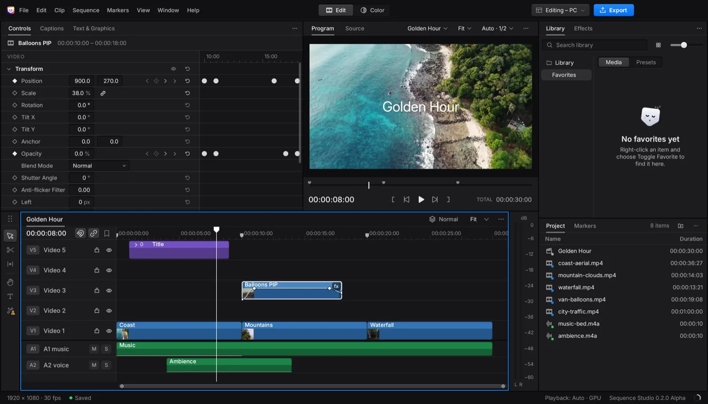

## For users

The editing window is a set of panels around the timeline, with a menu bar, a title row and a status bar. This page shows how to find your way around and how to arrange the panels.

### The title row

After the menu titles the title row shows the project name and when it was last edited, in the middle the **Edit | Color** page switch, and at the right end the **Workspace** popup and the **Export** button.

### The status bar

On the left: the format, the save state and a message. On the right: the version, the playback quality, the grade text and the Linked Selection chip. The export progress ring sits at the right end.

### Icons

All icons in the app are Lucide icons.

### Panels

Panels are tabs you can dock, resize, maximize or pull out into their own window. Window > panel name shows or hides a panel. The panels are: Project, Source, Timeline, Tools, Program, Controls (Effect Controls), Audio Meters, Effects, Library, Captions (Text), Graphics, Marker List, and on the Color page Color, Scopes, Sources and Steps.

#### Show or hide a panel

1. Open the **Window** menu.
2. Click the panel's name. A tick shows which panels are open.

#### Move or resize a panel

1. Drag the panel's tab.
2. Drop it on another group's edge to split, or on its tab strip to join.
3. To resize, drag the gap between two panels. A panel is never squeezed under its minimum.

#### Maximize, float or close a panel

1. Right-click the panel's tab.
2. Choose **Maximize Panel**, **Move to Floating Window** or **Close Panel**.

#### Save your layout

1. Arrange the panels.
2. Choose **Window > Workspaces > Save as New Workspace…** and name it.
3. To go back to a saved layout, pick it in **Window > Workspaces** or in the **Workspace** popup at the right of the title row. **Reset to Saved Layout** appears when the layout differs from the saved one.

The full tour of the panels, their focus keys, the monitors, the Library and the timeline header is in [Getting started](getting-started.md#a-tour-of-the-window). Keys can be changed in [Shortcuts](shortcuts.md).

### Not sure yet

- The factory position of each panel in each built-in workspace.

## For developers

- **Panel identity**: `PanelID` in `crates/sq-uikit/src/panel_id.rs` (16 panels, `PanelID::ALL`). Tools is the column left of the timeline. Steps and the Sources panel are dock tabs of the Color layouts only.
- **Dock**: `crates/sq-draw-shell/src/shell_dock.rs` draws the dockable layout (one card per tab group, tab strips, divider drags, tab drag onto a group edge). `shell_dock_shell.rs` holds the Window menu's workspace and panel rows and the panel commands (Show panel, Maximize, Reset to Saved Layout, next or previous panel). `shell_floating.rs` handles floating panels; Reset to Saved Layout puts every floating panel back.
- **Workspaces**: `WorkspaceStore` in `crates/sq-editor-session/src/es10_workspace/store.rs` knows which workspaces exist, which one shows (`WorkspacePage`: Edit or Color), the workspace each project opens in and the floating windows. Layout types are in `layout.rs`, docking in `docking.rs`.
- **Panel hosts**: `crates/sq-app-hosts/src/root.rs` owns every panel host in one `AppHost`; the dock gives a host its content frame, and panels without a host draw a placeholder card. Input goes to the dialog, then the menu, then the dock, then the hosts top-most first. Window chrome (title row, status bar, error line) is in `crates/sq-app-hosts/src/chrome/`.
- **Menus**: `shell_menu_bar.rs`, `menu_bar.rs`, `menu_controller.rs`. Command names are in `crates/sq-uikit/src/editor_command.rs`.
- **Tests**: `crates/sq-draw-shell/src/tests*.rs`, `crates/sq-app-hosts/src/chrome/tests.rs`, `crates/sq-editor-session/src/es10_workspace/tests/workspace.rs` and `store.rs`.
- **Extension points**: a new panel is a `PanelID` case plus a host in `sq-app-hosts` and a Window menu row.

## For AI agents

- **Panel ids** (declaration order): EffectControls, Text, ProgramMonitor, SourceMonitor, Library, Effects, Project, Timeline, Tools, AudioMeter, ColorInspector, Scopes, ColorClips, Steps, Graphics, MarkerList (`crates/sq-uikit/src/panel_id.rs`).
- **Invariants**: panels never shrink below their minimum in a divider drag; Steps and ColorClips are tabs of the Color layouts only; "Reset to Saved Layout" has something to restore only for the Color page or a built-in workspace with edits (`WorkspaceStore`, `store.rs`).
- **Input routing order**: dialog, menu, dock, then hosts top-most first (`crates/sq-app-hosts/src/root.rs`).
- **Files**: dock `crates/sq-draw-shell/src/shell_dock.rs`; Window menu rows `shell_dock_shell.rs` and `shell_menu_bar.rs`; workspaces `crates/sq-editor-session/src/es10_workspace/store.rs`; chrome `crates/sq-app-hosts/src/chrome/`.
- **Run tests**: `cargo test -p sq-draw-shell` and `cargo test -p sq-editor-session workspace` (heavy builds go through the project's remote wrapper).
