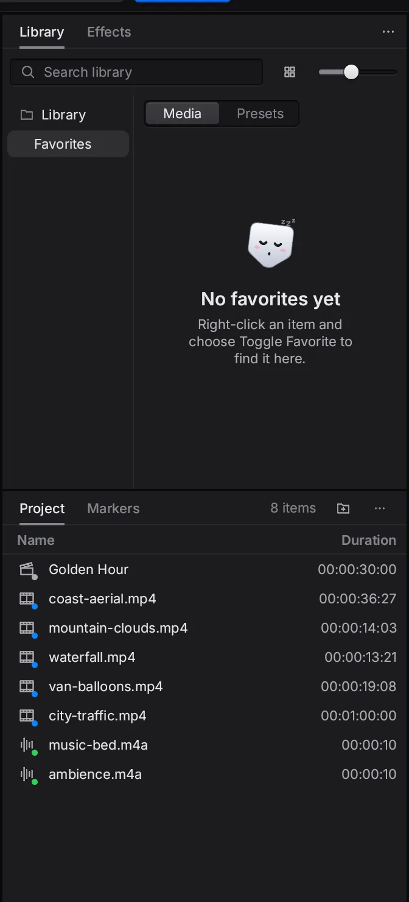

## For users

Bring footage, audio, stills, LUTs and fonts into a project, and keep editing smoothly with proxies.

### Bring files in

1. Choose **File > Import…** (Cmd+I on the Mac, Ctrl+I on Windows and Linux).
2. Pick one or more files. You can also drag files from your file manager into the Project panel.
3. The files appear in the **Project** panel.
4. Drag a clip onto the timeline to use it.

The Library panel has a **Media | Presets** switch and an **Import…** button. With no files yet it reads "No Media Yet".

How outside files are copied or referenced is explained in [Getting started](getting-started.md#where-do-imported-files-live).

### What the library accepts

The library sorts files by extension into Video (mp4, mov, m4v, mkv, avi, mxf, webm, mpg, mpeg, mts, m2ts, prores), Audio (wav, mp3, aif, aiff, aifc, m4a, aac, flac, caf, ogg, opus), Image (png, jpg, jpeg, heic, heif, tif, tiff, bmp, gif, webp, exr, dpx, psd), LUT (cube, 3dl, look, mga, m3d) and Font (ttf, otf, ttc, otc, woff, woff2). Video or images with an alpha channel are listed as Overlay. Animated GIF, APNG and WebP files and numbered image sequences become a normal clip. MXF files in the common OP1a form that cameras write are read directly.

### Watched folders and card import

A folder you add to the library is scanned including its subfolders and shown in sections: All, plus one per subfolder. A missing or unmounted folder is shown as offline, not as an error. The library has a name filter and sorting, and you can mark favorites. Import from an SD card or an external drive has its own window.

### Source timecode

The timecode a camera recorded is read from the file (the QuickTime timecode track first) and kept as an exact value, so clips line up with the camera's clock.

### Files that will not import

When a file cannot be read, Sequence Studio looks at the file itself and says what is wrong in plain words (missing, empty, wrong content, damaged container) instead of "could not read".

### Proxies

Proxies are light copies of heavy clips that the monitors use while you scrub or play. Settings has three modes: Auto (only where scrubbing would be slow), Always (every long-GOP source) and Off. Auto makes proxies for long-GOP sources that are heavy: from 4K up, or 10-bit and 4:2:2 sources near 4K, and on weak or low-memory computers or without a hardware decoder for smaller sizes. Intra-only formats such as ProRes seek fast and get none unless the computer has to decode them in software. A source with fields and Deinterlace off gets none, because a proxy has no fields. Proxies are ProRes 422 Proxy at half or quarter width and height. Playback uses ready proxies on weak computers and, in Auto, for any clip this computer can only decode in software (for example 4K 4:2:2 10-bit H.264); clips with a hardware decoder keep the original. Always uses them for every clip, Off never. Paused frames, stills while scrubbing and export always read the original. Export reads the original files unless you turn on Use proxies when exporting in Settings > Media. The proxy cache has a size limit; the least recently used proxies go first, never one a monitor is playing, and a background proxy never fills the disk (it keeps 5 GB or 2 percent of the volume free, whichever is larger). Colors always come from the original file.

### Not sure yet

- The exact menu names for import and the card import window.
- Where each proxy mode sits in Settings (Settings > Playback and Settings > Media hold the proxy options).

Related: [Export](export.md), [Troubleshooting](troubleshooting.md)

## For developers

### Crates

| Crate | Role |
|---|---|
| `sq-media` | Probing and demux/decode seams, MXF (`mxffile.rs`, `mxfklv.rs`, `mxfmetadata.rs`, `mxfdemuxer.rs`), WebM and Vorbis readers, camera metadata (`canon_metadata.rs`, `sony_metadata.rs`, `exif.rs`), source timecode, embedded LUTs, waveform peaks (`peak_pyramid.rs`, `waveform_disk_cache.rs`), thumbnail LRU, frame-rate conform math (`vfr_conform.rs`), still and animated images, media placement and file operations. No OS code. |
| `sq-library` | Library logic: folder scanning, watched folders, search and grouping, favorites, card import, preview requests and cache, presets (`preset_store.rs`), LUT collection, `.sqpack` bundles. |
| `sq-proxy` | Proxy planning, on-disk cache, job queue, lookup for playback. |

### Data flow

1. The platform opens a file through the seam in `sq-media/src/media_opener.rs`: a demuxer plus a video decoder. On the Mac VideoToolbox is tried first with FFmpeg as fallback; on Windows it is FFmpeg (D3D11VA or software). The engine only sees the traits.
2. A file that fails to probe goes to `MediaDiagnosis` (`media_diagnosis.rs`), which reads a few bytes and the top-level MP4/MOV atoms to name the problem.
3. Import placement (copy into the project folder or reference) follows one rule set in `media_placement.rs`; the copying is `MediaFileOps` in `media_file_ops.rs`.
4. `FolderScanner` (`sq-library/src/folder_scanner.rs`) walks a watched folder (max depth 24, max 100,000 entries, never follows links to directories) and returns `FolderScanResult::Online` or `Offline`. `LibraryItemKind::classify` sorts by extension. The file system watcher is a seam (`FolderWatching`); the app implements it, the crate has no OS code.
5. Proxies: `ProxyPolicy` decides from `SourceSeekInfo` (codec and largest sync distance; `FfmpegSeekProber` reads the first video packets and decodes nothing). `AutoProxyRule::decide` in `sq-proxy/src/auto_proxy.rs` combines mode, source and `MachineProfile` into `ProxyDecision::NeedsProxy(kind)` or `Skip(reason)`. `ProxyQueue` runs jobs (states Queued, Running, Done, Failed, Cancelled; priorities Background and user-requested) and `ProxyCache` stores the files keyed by (fingerprint, kind). `proxy_provider.rs` is the read-only lookup the playback engine uses.

### Extension points

- A new file type: add the extension to the lists in `library_item_kind.rs` (library) and, for import, the probe in `sq-media-ffmpeg`.
- A new preset kind in `.sqpack`: register it in `SQPackKindRegistry` (`sqpack.rs`); `kind` is a plain string and unknown kinds are skipped on import.
- Proxy rules: `AutoProxyRule::decide`; add a test beside it.

### Tests

Unit tests sit beside the code in each crate: `cargo test -p sq-media`, `-p sq-library`, `-p sq-proxy`.

## For AI agents

- Inputs: media file paths. Outputs: probe results (`VideoTrackInfo`), library entries (`LibraryEntry`), proxy files and `ProxyLookup`.
- Library kinds (`LibraryItemKind`): Audio, Video, Image, Overlay, Lut, Font, Other. Classification is by lower-cased extension only; `Overlay` needs the caller's `has_alpha` hint.
- Proxy kinds (`ProxyKind`): `Optimized` (ProRes 422, source size), `ProxyHalf`, `ProxyQuarter` (ProRes 422 Proxy, 1/2 and 1/4 width and height). Auto picks quarter from 2x UHD pixels, else half.
- Proxy modes (`ProxyMode`): `auto`, `always`, `off`. Playback modes (`ProxyPlaybackMode`): `Auto` (weak machine, or per media when its decoder is software: `AutoProxyRule::plays_proxy_for_media`), `On`, `Off`.
- Invariants: export never reads proxies unless "Use proxies when exporting" is on; a proxy's color interpretation is always `FromSource`; a proxy in use by a monitor is never evicted; `MxfFile` reads with positional reads and bounds-checks every length (malformed input returns an error, no panic); `.sqpack` is data only (JSON, assets checked by extension, header and SHA-256).
- Time is rational (`sq_core_time::Time`); `vfr_conform.rs` never uses floating point for slots.
- Files: `crates/sq-media/src/media_opener.rs`, `crates/sq-library/src/folder_scanner.rs`, `crates/sq-proxy/src/auto_proxy.rs`, `crates/sq-proxy/src/proxy_queue.rs`, `crates/sq-proxy/src/proxy_cache.rs`.
- Commands: `cargo test -p sq-media`, `cargo test -p sq-library`, `cargo test -p sq-proxy`.
