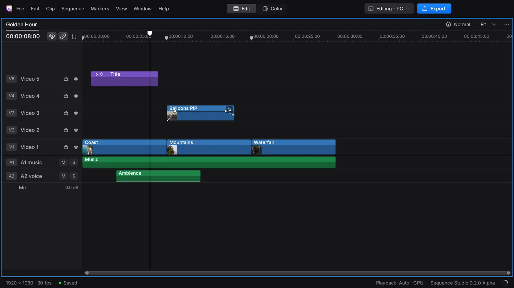
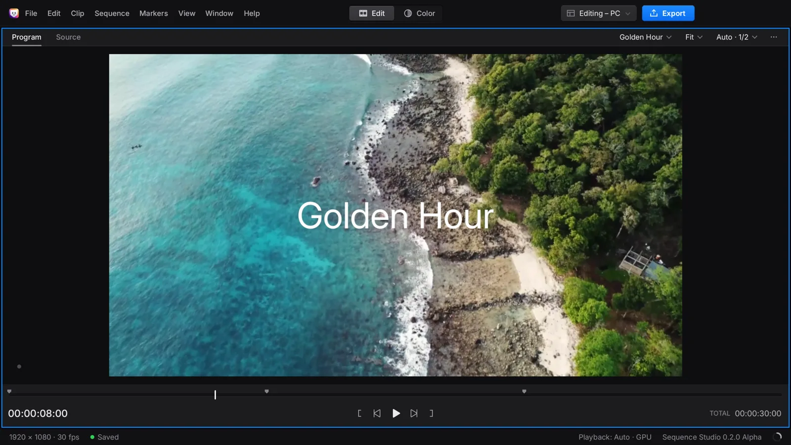

## For users

Build a video on the timeline: tracks, selecting, cutting, trimming, markers, nested sequences, speed, Fast Cut, proxies and floating monitors.

### Contents

1. [Before you start](#before-you-start)
2. [Tracks](#tracks)
3. [The playhead and playback](#the-playhead-and-playback)
4. [Marking In and Out](#marking-in-and-out)
5. [Tools](#tools)
6. [Selecting](#selecting)
7. [Put clips on the timeline: insert and overwrite](#put-clips-on-the-timeline-insert-and-overwrite)
8. [Cut and delete](#cut-and-delete)
9. [Trim: ripple, roll, slip and slide](#trim-ripple-roll-slip-and-slide)
10. [Linked clips and groups](#linked-clips-and-groups)
11. [Markers](#markers)
12. [Snapping](#snapping)
13. [Zoom and track height](#zoom-and-track-height)
14. [Combine clips into a nested sequence](#combine-clips-into-a-nested-sequence)
15. [Speed](#speed)
16. [Normal and Fast Cut sequences](#normal-and-fast-cut-sequences)
17. [Proxies and playback performance](#proxies-and-playback-performance)
18. [Floating panels and monitors](#floating-panels-and-monitors)
19. [Quick Apply](#quick-apply)
20. [Not sure yet](#not-sure-yet)

### Before you start

Mac keys come first, Windows and Linux keys second (Cmd is Ctrl, Option is Alt; Windows and Linux use the same keys). Shortcuts in this manual are the defaults of the **Sequence Studio** key set. You can change any key in **Keyboard Shortcuts…** (Cmd+Option+K / Ctrl+Alt+K), see [Getting started](getting-started.md#change-a-keyboard-shortcut).

Some default shortcuts use the Control key on the Mac. They are left out of the tables below. On Windows and Linux they may share a key with a Ctrl shortcut. Use the menu, or look the key up in Keyboard Shortcuts.

A word about time: Sequence Studio counts time in exact frames, so cuts never drift.

### Tracks

When no track holds a clip, the timeline shows "Drag Clips Here" with an **Import…** button.

A sequence has video tracks (V1, V2 and so on) and audio tracks (A1, A2 and so on). Higher video tracks sit on top of lower ones.

Each track header has three buttons:

- **Mute Track** silences or hides the track.
- **Solo Track** plays only that track.
- **Lock Track** stops any edit on the track.

Right-click a track header for more, including **Rename Track**.

#### How to add or remove tracks

1. Choose **Sequence > Tracks and Transitions**.
2. Pick **Add Video Track**, **Add Audio Track**, **Delete Track** or **Remove Empty Tracks**.

The **...** menu in the timeline header has the same **Add Video Track**, **Add Audio Track** and **Remove Empty Tracks**, plus **Minimize All Tracks**, **Expand All Tracks**, **Snapping** and **Linked Selection**.

Track targets decide where **Insert**, **Overwrite** and paste put new clips. Each track has a target chip. While the Source monitor holds a clip, a column left of the chips shows which track receives its video ("V") and audio ("A").

To change targets from the keyboard use **Sequence > Tracks and Transitions > Track Targets**: **Toggle Video Targets** (Cmd+9 / Ctrl+9), **Toggle Audio Targets** (Cmd+0 / Ctrl+0), **Lock or Unlock Targeted Tracks**.

### The playhead and playback

The playhead is the line that marks "now". The Program monitor shows the frame under it.

#### How to move the playhead

- Click or drag in the ruler.
- Use the keys in the table.
- Type a time with **Sequence > Go To > Go to Timecode…**.

| Action | Mac | Windows and Linux |
|---|---|---|
| Play / pause | Space | Space |
| Play backward / stop / play forward | J / K / L | J / K / L |
| Faster | press J or L again | press J or L again |
| Change the speed by a quarter step (from a stop: 1.25x forward or backward) | Shift+J / Shift+L | Shift+J / Shift+L |
| One frame back / forward | Left / Right | Left / Right |
| 10 frames back / forward | Shift+Left / Shift+Right | Shift+Left / Shift+Right |
| Previous / next edit | Up / Down (timeline) | Up / Down (timeline) |
| Previous / next edit on any track | Shift+Up / Shift+Down | Shift+Up / Shift+Down |
| Go to start / end | Home / End | Home / End |
| Go to start / end of selected clip | Shift+Home / Shift+End | Shift+Home / Shift+End |
| Play In to Out | Option+K | Alt+K |
| Play Around the playhead | Shift+K | Shift+K |
| Loop Playback | Control+L | menu (View > Playback) |
| Show in Source (find the clip's source frame) | F | F |

Play Around uses the **Preroll** and **Postroll** times in **Settings > Playback**.

**End** puts the playhead at the end of the sequence, after the last frame. Insert, Overwrite and Paste from there add to the end and leave the last clip whole. In the Source monitor, End shows the last frame of the file.

### Marking In and Out

An In point and an Out point mark a part of a clip (in the Source monitor) or of the sequence.

| Action | Mac | Windows and Linux |
|---|---|---|
| Mark In / Mark Out | I / O | I / O |
| Mark Clip | X | X |
| Go to In / Go to Out | Shift+I / Shift+O | Shift+I / Shift+O |
| Remove In / Remove Out | Option+I / Option+O | Alt+I / Alt+O |
| Remove In and Out | Option+X | Alt+X |

### Tools

The tool strip next to the timeline has six slots: **Select**, **Blade**, **Slip**, **Hand**, **Create** and **Mask**. All other tools are on keys and in the right-click menu of the tool strip. **View > Tools** lists them too. The strip is its own panel: **Window > Tools** shows or hides it.

| Tool | Key | What it does |
|---|---|---|
| Select Tool | V | Select, move and trim clips |
| Select Forward Tool | A | Select every clip to the right on the track |
| Select Backward Tool | Shift+A | Select every clip to the left on the track |
| Ripple Tool | B | Trim an edge and move everything after it |
| Roll Tool | N | Move the cut between two clips |
| Slip Tool | Y | Move the content inside a clip, the clip stays |
| Slide Tool | U | Move a clip, its neighbors adjust |
| Stretch Tool | R | Change a clip's speed by dragging its edge |
| Blade Tool | C | Cut a clip where you click |
| Hand Tool | H | Scroll the timeline. Over the Program monitor it pans a zoomed picture (double-click fits it) |
| Zoom Tool | Z | Zoom the timeline |
| Type Tool (Create) | T | On the Program monitor: click to place text, drag to draw a text box. Double-click text or a caption on the picture to edit it in place. Hold the tool for the shape modes |
| Create Tool, shape and Draw modes | T (hold) | On the Program monitor: drag out a shape, or draw a freehand line. The shape or stroke becomes a layer of the selected Graphic clip, or a new Graphic clip at the playhead. **Sequence > New > Layer > New Shape** makes a shape the same way |
| Mask Tool | P | Mask the selected clip. Hold for the mask type |
| Position Tool | Shift+V | Fast Cut only. See [below](#normal-and-fast-cut-sequences) |

How tool keys work:

- Tap a key to switch to the tool and stay there.
- Hold a key to use the tool for a moment. When you let go, you are back in the tool you had. Example: hold C, cut, release.
- Esc returns to the Select Tool (unless a drag is running: then Esc cancels the drag).

### Selecting

| Action | Mac | Windows and Linux |
|---|---|---|
| Select All / Deselect All | Cmd+A / Shift+Cmd+A | Ctrl+A / Ctrl+Shift+A |
| Select Clip at Playhead | D | D |
| Select Next / Previous Clip | Cmd+Down / Cmd+Up | Ctrl+Down / Ctrl+Up |
| Select Left Edge / Right Edge | menu (Edit > Select) | menu (Edit > Select) |
| Move selection to the track above / below | Option+Up / Option+Down | Alt+Up / Alt+Down |

You can also drag on empty space to draw a box around clips. Right-click a clip for its menu: cut, copy, **Paste Special**, disable, link, **Label**, rename and delete on the first level, and **Speed**, **Audio**, **Frame**, **Color**, **Arrange** (group, bundle, combine) and **Save** as submenus. New Color Matte… is under Sequence > New > Layer.

### Put clips on the timeline: insert and overwrite

- **Insert** puts the clip at the playhead and pushes everything after it to the right.
- **Overwrite** puts the clip at the playhead and replaces whatever is under it.

| Action | Mac | Windows and Linux |
|---|---|---|
| Insert | `,` | `,` |
| Overwrite | `.` | `.` |
| Place on Top | Shift+`.` | Shift+`.` |

#### How to edit a clip in from the Source monitor

1. Open the clip in the Source monitor (right-click it in the Project panel, then **Open in Source**).
2. Mark In and Out with I and O.
3. Check the track targets in the timeline.
4. Move the playhead to where the clip should go.
5. Press `,` for Insert or `.` for Overwrite. You can also click the **Insert** or **Overwrite** button on the Source monitor.

You can also drag a clip onto the timeline, or onto the Program monitor, where two drop zones named **Insert** and **Overwrite** appear.

**Place on Top** puts the Source clip, or else the selected Project item, on the lowest free video track above the topmost clip at the playhead. It places video only. It is made for b-roll over a talking head.

**Paste Insert** (Shift+Cmd+V / Ctrl+Shift+V) and **Paste to Targeted Track** are in **Edit > Paste Special**.

### Cut and delete

| Action | Mac | Windows and Linux |
|---|---|---|
| Add Edit (cut at the playhead) | Cmd+K | Ctrl+K |
| Add Edit to All Tracks | Shift+Cmd+K | Ctrl+Shift+K |
| Blade Tool | C | C |
| Delete | Delete | Backspace |
| Ripple Delete | Shift+Delete | Shift+Backspace |
| Clear Range (lift) | `;` | `;` |
| Delete Range (extract) | `'` | `'` |
| Cut Out | Shift+X | Shift+X |

What they do:

- **Add Edit** cuts the clip under the playhead on the targeted tracks. **Add Edit to All Tracks** cuts on every unlocked track. Press Cmd+K twice and the piece between the last two cuts is selected, ready to delete.
- **Delete** follows the sequence mode. In a Normal sequence it removes the clip and leaves a gap. In a Fast Cut sequence it closes the gap.
- **Insert** (and Paste Insert, Source Insert) never changes the length of a caption. Captions that start at or after the insert point move later with the clips; a caption that the insert point lies inside stays where it is and keeps its length.
- **Backspace on a gap** closes only the part that is empty on every track. When a caption or a clip on another track keeps it from closing fully (even when only one frame or nothing can close), the status line says "Ripple Delete limited by content on another track." each time.
- **Ripple Delete** always closes the gap and removes the captions that sat on the deleted clips. A ripple trim stops at a caption in the span it would close instead of deleting it, and the status line says so ("Ripple limited by a caption."). In Fast Cut, where the main track always closes, a trim, speed change or replace does not delete a caption in the freed end either: the caption moves to the new end of the clip and keeps its length (captions that would overlap there follow one another).
- **Clear Range** removes what is between In and Out and leaves a gap. **Delete Range** removes it and closes the gap.
- **Cut Out**: the first press marks a start at the playhead. The second press removes everything from the start to the playhead on the targeted tracks (or all unlocked tracks) and closes the gap. It is one undo step.
- **Sequence > Edit > Split and Join** has more: **Join Cuts**, **Close Gap at Playhead**, **Jump Cut to Alternate Track**.

#### J cut and L cut

A J cut lets the sound of the next clip start before its picture. An L cut lets the sound of a clip carry on after its picture.

1. Put the playhead near a cut.
2. Press Option+J for **J Cut (Audio Leads)** or Option+L for **L Cut (Audio Trails)**. (Windows and Linux: Alt+J, Alt+L.)

The audio edit of the nearest cut moves to the playhead and the picture stays. More are in **Sequence > Edit > Split Edits**, including **Nudge Audio Edit** and **Nudge Video Edit** by one frame.

### Trim: ripple, roll, slip and slide

#### Trim by dragging

1. Use the Select Tool and drag the edge of a clip to make it shorter or longer.
2. Or pick another tool: Ripple (B), Roll (N), Slip (Y) or Slide (U) and drag.

What each one changes:

| Tool | The clip you drag | What happens to the rest |
|---|---|---|
| Select (trim) | its edge moves | a gap opens or closes beside it |
| Ripple | its edge moves | everything after it moves along |
| Roll | the cut moves | both clips change, total length stays |
| Slip | the content moves inside the clip | clip position and length stay |
| Slide | the clip moves | the neighbors get shorter or longer, total length stays |

#### Trim to the playhead

These keys work in the timeline. Q, E and W follow Sequence Studio's own key set.

| Action | Mac | Windows and Linux |
|---|---|---|
| Ripple Trim Previous Edit to Playhead | Q | Q |
| Ripple Trim Next Edit to Playhead | E | E |
| Extend Selected Edit to Playhead | W | W |
| Roll Previous / Next Edit to Playhead | Shift+Q / Shift+W | Shift+Q / Shift+W |
| Trim Previous / Next Edit to Playhead | Option+Q / Option+W | Alt+Q / Alt+W |

#### Trim and move by keys

| Action | Mac | Windows and Linux |
|---|---|---|
| Trim Backward / Forward 1 frame | Option+Left / Option+Right | Alt+Left / Alt+Right |
| Trim Backward / Forward 10 frames | Option+Shift+Left / Right | Alt+Shift+Left / Right |
| Nudge selected clips 1 frame | Cmd+Left / Cmd+Right | Ctrl+Left / Ctrl+Right |
| Nudge selected clips 10 frames | Shift+Cmd+Left / Right | Ctrl+Shift+Left / Right |
| Slip selected clips 1 frame | Option+Cmd+Left / Right | Ctrl+Alt+Left / Right |
| Slip selected clips 10 frames | Option+Shift+Cmd+Left / Right | Ctrl+Alt+Shift+Left / Right |
| Slide selected clips 1 frame | Option+`,` / Option+`.` | Alt+`,` / Alt+`.` |
| Slide selected clips 10 frames | Option+Shift+`,` / `.` | Alt+Shift+`,` / `.` |

#### Trim mode

Trim mode shows the two sides of a cut side by side so you can fine-tune it.

1. Double-click near the edge of a clip that is long enough on screen, with the Select Tool. Trim mode opens at that edit.
2. Or choose **Sequence > Edit > Trim Selected Edit > Trim Mode**.
3. Use **Toggle Trim Type** to switch which side moves: **Before**, **After** or **Both**.
4. In Trim mode Shift+arrows move 10 frames.

### Linked clips and groups

- A video clip and its audio are linked. **Linked selection** (button in the timeline header, or **Sequence > Linked Selection**) makes linked clips select together. Turn it off to select only one of them.
- **Link** and **Unlink** are in the clip menu and in **Clip > Link and Group**. Cmd+L / Ctrl+L links the selection.
- **Group** (Cmd+G / Ctrl+G) and **Ungroup** (Shift+Cmd+G / Ctrl+Shift+G) hold several clips as one.
- **Bundle** and **Unbundle** (Option+Cmd+G / Ctrl+Alt+G, add Shift for Unbundle) are for a selection of clips you want to keep together.
- **Detach Audio**, **Solo Selected Tracks** and **Mute Selected Tracks** are in **Clip > Arrange**.

### Markers

A marker is a flag on the sequence. A clip marker is a flag on one clip.

#### How to add and use markers

1. Move the playhead where you want a marker.
2. Press M (or click **Add marker** in the timeline header, or use the **Markers** menu).
3. To give it a name, color and comment, choose **Markers > Marker > Add and Edit Marker…** or **Edit Marker…**.
4. In the dialog set **Name**, **Color**, **Duration** (sequence markers only) and **Comment**. Click **OK**, or **Delete Marker**.

A clip marker is added from a clip's right-click menu: **Add Clip Marker**. Right-click it later to **Edit Clip Marker…** or **Delete Clip Marker**.

Marker colors: green, red, purple, orange, yellow, white, blue and cyan.

| Action | Mac | Windows and Linux |
|---|---|---|
| Add Marker | M | M |
| Go to Next Marker | Shift+M | Shift+M |
| Go to Previous Marker | Shift+Cmd+M | Ctrl+Shift+M |
| Clear Selected Marker | Option+M | Alt+M |
| Mark Selection (sets markers around the selected clips) | `/` | `/` |

More are in the **Markers > Marker** submenu: **Clear All Markers**, **Markers on Beat**, **Markers on Downbeats**, **Keyword at Playhead**. The **Marker List** panel lists all markers; click a column head (Time, Name, Length) to sort, double-click a name to rename the marker, and the ••• menu has **Export CSV…**.

### Snapping

With snapping on, clips and the playhead jump to nearby edits, markers and the playhead when you drag. The magnet button in the timeline header turns it on and off.

| Action | Mac | Windows and Linux |
|---|---|---|
| Turn snapping on or off | S | S |
| Flip snapping while you drag | hold S | hold S |
| Make the playhead stick to edits and markers while scrubbing | hold Shift | hold Shift |

When a sequence has beats, right-click for **Beat Snap**: **Every Beat** or **Bars Only**.

### Zoom and track height

| Action | Mac | Windows and Linux |
|---|---|---|
| Zoom In | `=` | `=` |
| Zoom Out | `-` | `-` |
| Zoom to Fit | `\` | `\` |
| Taller video tracks / shorter | Cmd+`=` / Cmd+`-` | Ctrl+`=` / Ctrl+`-` |
| Taller audio tracks / shorter | Option+`=` / Option+`-` | Alt+`=` / Alt+`-` |
| Expand All Tracks / Minimize All Tracks | Shift+`=` / Shift+`-` | Shift+`=` / Shift+`-` |

You can also pinch on a trackpad, or use the **Fit** menu in the timeline header: **Fit Sequence**, **Zoom In**, **Zoom Out**, **Taller Tracks**, **Shorter Tracks** and **Fit All Tracks to Height**.

Track height options are in **View > Track Height**. Timeline thumbnails (**Head**, **Head and Tail**, **Continuous**) are in **View > Timeline Thumbnails**.

### Combine clips into a nested sequence

Combine turns several clips into one clip that holds them. Inside it is a sequence of its own.

#### How to combine clips

1. Select the clips.
2. Right-click one of them and choose **Combine…**.
3. Type a name for the new sequence. The default is "Combined 01".
4. Click OK. The clips are now one clip.

#### Work inside a combined clip

- Double-click the combined clip to open its sequence. The timeline header then shows where you are, for example "Main > Inner".
- Right-click a combined clip and choose **Unnest** to put the clips back.
- In the **Fit** menu of the timeline header, **Place Sequences as Clips** makes a sequence that you drop or insert land as its own clips instead of one combined clip.

### Speed

#### How to change the speed of a clip

1. Select the clip.
2. Choose **Clip > Speed…** (Cmd+R / Ctrl+R).
3. Type a **Speed** in percent, or type a **Duration**. The two are linked: change one and the other follows.
4. For video, pick **Frames**: repeat frames or blend frames.
5. Tick **Reverse** to play backward. Tick **Keep Pitch** to keep the voice pitch (only for clips with audio). Tick **Move Later Clips** to close or open the gap after the clip. A caption in the freed end of the clip is never deleted: the gap closes only up to that caption and the status line says so. In Fast Cut the main track closes fully and the caption moves to the new end of the clip.
6. Click **OK**.

More ways:

- **Reverse Clip** is in the **Clip** menu.
- The Stretch Tool (R) changes speed by dragging a clip edge.
- **Show Speed Ramp** (**Clip > Timing**) puts a speed lane on the clip. **Add Speed Point** adds a point. **Remove Speed Ramp** takes it away.
- **Clip > Timing > Speed Ramp Presets** has ready ramps, also in a version that follows the beat.

### Normal and Fast Cut sequences

Every sequence is in one of two modes.

| | Normal | Fast Cut |
|---|---|---|
| Idea | Classic tracks. Every edit stays where you put it. | The main track closes gaps by itself. Clips above and below stay attached to their clip. |
| Delete | Leaves a gap | Closes the gap |
| Ripple Delete | Closes the gap | Closes the gap |

#### How to switch the mode

- Click the **Normal** / **Fast** chip in the timeline header and pick **Normal** or **Fast Cut**.
- Or press Shift+G in the timeline.
- Or use **Sequence > Fast Cut**.

Switching moves no clip and is one undo step. The mode is stored for each sequence. New sequences start in the mode you set in **Settings > Editing** under **New Sequences Start in**, or choose it in the New project dialog.

#### Words used in Fast Cut

- **Main track**: V1 in Fast Cut.
- **Attached clip**: a clip on another track that follows a main-track clip.
- **Attach thread**: the thin line from an attached clip to the clip it hangs on.
- **Attach point**: the place on the main-track clip where the attached clip hangs.
- **Spacer**: a deliberate empty piece on the main track.
- **Storyline**: a group of attached clips that are held together.

#### The Fast Cut strip

In a Fast Cut sequence a strip with five buttons appears in the timeline header:

| Button | What it does | Mac key |
|---|---|---|
| Append | Adds the Source clip (or the selected Project item) to the end of the main track | Control+E |
| Spacer | Inserts an empty spacer of 3 seconds at the playhead | Control+W |
| Lift off | Moves the selected main-track clips above the main track, leaving a spacer | Option+Cmd+Up |
| Put on | Moves the selected attached clips onto the main track | Option+Cmd+Down |
| Storyline | Groups the selected attached clips into one storyline | Control+G |

On Windows and Linux use the strip buttons or the **Sequence** menu (Storyline and Fast Cut submenus).

Other Fast Cut commands:

- **Set Attach Point** (menu only) sets the attach point at the playhead.
- **Attach Backtimed** and **Paste Attached** (Option+V / Alt+V) are in **Sequence** and **Edit > Paste Special**.
- **Move Clip Left**, **Move Clip Right** and **Delete Selection Only** (Option+Cmd+Delete) are in **Sequence > Fast Cut**.
- **Ripple Delete in Storyline** is in the Storyline submenu.
- Hold the backquote key (`` ` ``) while you delete, drag or trim to leave attached clips on their frame.
- The **Position Tool** (Shift+V): a dragged clip overwrites where it lands and leaves a hole.

### Proxies and playback performance

A proxy is a lighter copy of a heavy clip that plays smoothly. Sequence Studio makes them for you.

- Proxies are made in the background, one at a time, while you edit. Turn this off in **Settings > Playback > Background Work** ("Make proxies while you edit"). The work also pauses by itself when the Mac is hot or memory runs low.
- Scrubbing uses a ready proxy. Playback uses it on a weak Mac. A proxy shows the same colors as its original, so a scrubbed frame and the frame you stop on look alike.
- Paused frames and export use your original files, unless you turn on **Settings > Media > Export > Use proxies when exporting**. That is only for drafts, because the quality is lower. It is off by default.
- **Settings > Media > Cache Size** limits the disk space for proxies (the least recently used go first). **Cache Folder** moves them. **Delete Cache** clears them; they are rebuilt when needed.

More ways to keep playback smooth, all in **Settings > Playback**:

| Setting | What it does |
|---|---|
| Preview Quality | Playback resolution of the monitors: Auto, Full, 1/2 or 1/4. Auto picks 1/2 on computers with 8 GB of memory or less and lowers it when memory runs low. You can change it in the monitor at any time |
| Frame Cache | Memory for decoded frames. More plays smoother |
| Dropped Frames | Shows a small dot in the Program monitor that turns amber for two seconds when a frame drops |
| Audio Output | The sound device of both monitors |

Hardware decoding is used where your computer supports it: VideoToolbox on the Mac, D3D11VA on Windows and VA-API on Linux. On Linux the graphics card's decoder is one shared engine, so only big pictures (3 megapixels and more, for example 4K) go to it; smaller clips are decoded by the processor, because several small clips would queue behind one big picture. If the graphics driver cannot decode a clip, Sequence Studio decodes it by software instead. Playback uses the same engine as export.

### Floating panels and monitors

Any dockable panel can leave the main window. This is handy for a second display.

#### How to float a panel

1. Right-click the panel's tab.
2. Choose **Move to Floating Window**.

Or drag the tab and let go outside the main window.

On all three systems a floating panel is a window of its own, with its own title bar. Choosing **Maximize Panel** on a floating panel brings it to the front. For now floating windows open on the main screen.

The panel keeps its place in the layout. When you dock it again it goes back to the exact spot. Floating panels are remembered for each workspace. If a second display is unplugged, a floating window moves back onto a screen you have.

Panels you can float include the Source and Program monitors. Pick **Maximize Panel** in the tab menu, or press the backquote key, to fill the window with one panel.

The tool strip can also float: drag its grip and let go anywhere. Double-click the grip to put it back on the left.

### Quick Apply

Quick Apply is a search popup. It puts an effect, a transition, a preset or a command on your selection without leaving the keyboard.

#### How to use Quick Apply

1. Select a clip.
2. Press Option+Space (Ctrl+Space on Windows and Linux), or choose **Window > Quick Apply…**.
3. Type a few letters, for example "blur". The field says "Apply effect, transition or preset".
4. Move to a result with the arrow keys and press Return.
5. For a transition, choose where it goes: Left is the start, Right is the end, Down is both. Return confirms and Esc goes back.
6. Esc closes the popup.

To move the popup, drag the small grip bar on its top edge (the hand cursor shows there) or any empty part of the card. It follows the pointer exactly and stays inside the window. It opens at the default spot again next time.

What it finds: video and audio effects, transitions, built-in presets, your Library presets and the menu commands. Recent choices are marked "Recent". It shows "No results" when nothing matches.

A built-in macro named **Clean Voice** runs Voice Chain and Match Loudness together as one undo step.

### Not sure yet

- The modifier key for zooming the timeline with the scroll wheel (pinch is confirmed).
- Windows and Linux keys for shortcuts that use the Control key on the Mac. They may be shared with Ctrl shortcuts, so use the menus or Keyboard Shortcuts there.
- Whether Alt plus the mouse wheel zooms the timeline on every Linux desktop (some desktops keep Alt for moving windows).
- The menu where Proxy mode (Auto, Always, Off) and proxy playback can be chosen. Only the Background Work and export options are confirmed.
- Exact behavior of the box selection (drag on empty space) with the Shift key.
- How a project with many layers plays on Windows. The size rule for the graphics card's decoder (3 megapixels and more) was measured on Linux; on Windows every clip the card can decode goes to it.

Related: [Getting started](getting-started.md)

## For developers

Editing is split in four layers; each depends only on the ones above it in this list.

1. `crates/sq-core-model` holds the value types (`Project`, `Timeline`, `Track`, `Clip`, `TimelineEditMode` with `Normal` and `Magnetic`; the user-facing name of `Magnetic` is Fast Cut).
2. `crates/sq-core-edit` holds the edit logic as functions over those values, with no UI and no platform imports: one module per operation (`timeline_edits.rs`, `timeline_batch_ripple.rs`, `timeline_trim_to_playhead.rs`, `timeline_trim_mode.rs`, `timeline_speed.rs`, `timeline_freeze_frame.rs`, `timeline_source_edit.rs`, `timeline_three_point.rs`, `timeline_replace*.rs`, `timeline_clipboard.rs`, `timeline_duplicate.rs`, `timeline_enable.rs`, `timeline_solo.rs`), plus `snapping.rs` (`snap`, `snap_move` to `SnapPoint`s), `grouping.rs` and `nesting_*.rs` (nested sequences, Group, Ungroup, Unnest), `history.rs` and the Fast Cut engine (`timeline_magnetic.rs` with `timeline_magnetic_ops.rs`, `_verbs.rs`, `_moves.rs`).
3. `crates/sq-editor-session` holds `EditorSession`: the project, undo history, active sequence, playhead and selection. Its modules `es01_session_core` to `es10_workspace` are `impl EditorSession` blocks by topic (`es02_timeline_ops` timeline edits, `es03_fast_cut` Fast Cut, speed, jump cut, cut check). Every edit goes through `EditorSession::perform(name, key, |project| ...)` (`session.rs`), which makes one undo step; consecutive edits with the same `key` merge into one step, and `end_gesture` closes a drag's step. Undo is a snapshot history (`sq-core-edit/src/history.rs`, `History<S>`). Views read state each frame and key their caches on `EditorSession::version(Change::...)`; changes are bit flags (`change.rs`).
4. UI: `crates/sq-timeline-ui` is the portable view logic with no drawing (`timeline_geometry.rs`, `timeline_zoom.rs`, the gesture reducer `timeline_interaction.rs`, `tool_strip_model.rs`, `timeline_menu_spec.rs`, `track_sizing.rs`, `skimmer.rs`, `razor_guide.rs`). `crates/sq-draw-timeline` is the panel that draws and routes input (`panel.rs`, `input.rs`, `draw.rs`, `lanes.rs`, `header.rs`, `ruler.rs`, `tool_strip.rs`, `fast_cut.rs`, `speed_band.rs`).

Data flow of a mouse edit: `sq-draw-timeline` forwards pointer events to `TimelineInteraction` (`sq-timeline-ui`). During a drag it edits a preview copy of the timeline (`preview()`) and collects `pending_edits`. On mouse up it emits `TimelineAction::Commit(TimelineCommit)` (`sq-draw-timeline/src/action.rs`). `session_bridge.rs` hands that to `EditorSession::commit` (`es01_session_core/editing.rs`), which replays the `TimelineEdit` list on the real timeline as ONE undo step, so a replayed edit always yields the same result. Keys arrive as `EditorCommand`s ([Shortcuts](shortcuts.md)) and run through the same session methods.

Fast Cut: `timeline_magnetic.rs` has the one engine, `magnetic_edit`, that every Fast Cut verb runs through. It decides who follows whom by the stored attachments, not by sync lock. In Normal mode the same verbs run as classic track edits.

Tests: `cargo test -p sq-core-edit` (unit tests next to each module; seeded fuzz tests of the Fast Cut verbs in `magnetic_fuzz_tests.rs`, `magnetic_fuzz_more_tests.rs`, `magnetic_fuzz_bypass_tests.rs` and `batch_ripple_fuzz_tests.rs`), `cargo test -p sq-editor-session`, `cargo test -p sq-timeline-ui`, `cargo test -p sq-draw-timeline` (panel and interaction tests such as `panel_tests.rs`, `key_tests.rs`, `drop_tests.rs`). Floating panels and monitors are built in the shell (`crates/sq-draw-shell/src/shell_floating.rs`) and stored by `es10_workspace`.

Extension points: a new edit is a pure function in `sq-core-edit` with a test written first, a `TimelineEdit` variant (if a gesture produces it) and a session method in `es02_timeline_ops` that calls `perform`. A new tool or gesture goes into `TimelineInteraction` and `tool_strip_model.rs`. Playback and proxy work are separate crates (`sq-playback`, `sq-proxy`).

## For AI agents

- Invariants of a timeline after any edit (checked by the Fast Cut fuzz tests in `crates/sq-core-edit/src/magnetic_fuzz_tests.rs`): tracks are valid (no overlaps, nothing at a negative time); in Fast Cut every attachment is valid and V1 gains no hole except through the spacer verbs; undo restores the exact snapshot before the edit and redo the one after it; switching between Normal and Fast Cut moves no clip; a Normal-only run stores no attachment.
- Time is rational (`sq_core_time::Time`, value and timescale), never a float.
- Every mutation goes through `EditorSession::perform(name, key, edit)` or `try_perform` (a failing edit leaves the project untouched). One call is one undo step. Never mutate the project directly from a view.
- A finished timeline gesture is `TimelineCommit { timeline, edits, undo_name, selection, caption_selection }` (`crates/sq-editor-session/src/es01_session_core/editing.rs`); applying it replays `edits` (`TimelineEdit`) as one step.
- Snapping: `sq_core_edit::snapping::snap(t, points, threshold, frame_duration)` and `snap_move`. The panel passes the playhead and marker times as snap targets (`TimelineInteraction::playhead`, `markers`).
- Mode: `TimelineEditMode::{Normal, Magnetic}` in `crates/sq-core-model/src/clip_attachment.rs`; Magnetic is shown to users as Fast Cut.
- Where to look: edit logic `crates/sq-core-edit/src/timeline_*.rs`; session methods `crates/sq-editor-session/src/es02_timeline_ops/` and `es03_fast_cut/`; gesture reducer `crates/sq-timeline-ui/src/timeline_interaction.rs`; panel `crates/sq-draw-timeline/src/`.
- Layer rules: `sq-core-edit` imports no AppKit, AVFoundation or UI crate; `sq-timeline-ui` does no drawing. Edit logic gets a test first.
- Commands: `cargo test -p sq-core-edit`, `cargo test -p sq-editor-session`, `cargo test -p sq-timeline-ui`, `cargo test -p sq-draw-timeline`; add a test name after the package to filter.
- When a visible behavior or shortcut changes, update this page and [Shortcuts](shortcuts.md) in the same change.
